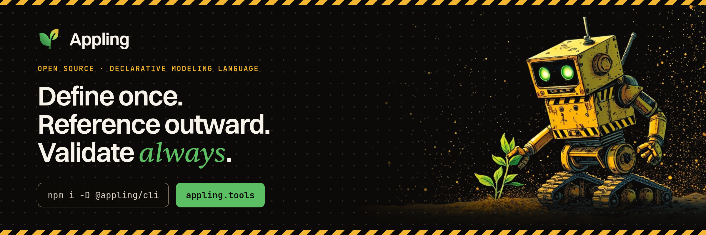

Appling is a declarative language that describes a business or web application as one validated model. The model covers what exists, what can happen, how capabilities are organized and exposed, and how people interact with them.

The text is the canonical source of truth. Parsed and linked, it becomes a semantic graph that tools validate, visualize, edit with AI and generate draft Django or Ash projects from.

The documentation is at [appling.tools/docs](https://appling.tools/docs/) and in [docs/](docs/index.md).

```
module sales {
  export Order

  enum OrderStatus {
    draft
    placed
  }

  entity Order {
    reference: String unique
    status: OrderStatus state default draft
  }

  action PlaceOrder on Order {
    requires { reference != "" }
  }

  machine OrderFlow on Order.status {
    transition draft -> placed via PlaceOrder
  }
}
```

## Model structure

| Layer | Describes | Declarations |
|---|---|---|
| Cross cutting | Modules, identity and access, evolution | `module`, `role`, `actor`, `tenant`, `migration` |
| L1 Domain | What exists | `enum`, `value`, `entity`, `invariant`, `policy` |
| L2 Behavior | What can happen | `event`, `action`, `machine`, `job` |
| L3 Application | How capabilities are organized | `query`, `projection`, `external`, `usecase` |
| L4 Interfaces | How programs reach them | `interface` |
| L5 Experience | How people reach them | `page`, `navigation`, `flow`, `messages` |

Each concept is defined once in the layer that owns it. References only point down the layers, interfaces and pages reach data only through projections, and modules only see what other modules export. Every element is identified by its qualified name, such as `sales.Order.status`, and renames are recorded as `migration` steps.

The language is documented in [docs/language](docs/language/overview.md); the full design is in [concept.md](docs/concept.md).

## Packages

| Package | Purpose |
|---|---|
| [`@appling/cli`](packages/cli) | The `appling` command: `check`, `fmt`, `graph`, `release`, `generate` |
| [`@appling/lang`](packages/lang) | The language: grammar, scoping, validation, expression typing, canonical printer and language server, built on [Langium](https://langium.org) |
| [`@appling/model`](packages/model) | The semantic graph, edit operations and releases with automatic migration steps |
| [`@appling/ide`](packages/ide) | A local IDE: text next to a map of modules and entities, a search over every element, an inspector that edits, AI chat with reviewable proposals |
| [`@appling/ai`](packages/ai) | MCP server, model adapter and the skill that works through a generated project's task registry |
| [`@appling/codegen`](packages/codegen) | Code generation core: plan, step runner, extension contract, task registry, migrations |
| [`@appling/codegen-django`](packages/codegen-django) | Django extension |
| [`@appling/codegen-ash`](packages/codegen-ash) | Ash extension |

```sh
npx @appling/cli check models
npx @appling/cli fmt models
npx @appling/ide models
npx @appling/cli generate --plan models
```

## Development

Developed with Node.js 24. pnpm is pinned through `packageManager` in `package.json`. Run `corepack enable` once so `pnpm` uses the pinned version.

```sh
pnpm install
pnpm build            # generates the parser, then compiles every package
pnpm test             # vitest over every package
pnpm check examples   # validates the sample models
pnpm fmt examples     # canonical formatting
```

`check` and `fmt` run the built CLI, so rebuild after changing the grammar or sources.

```
packages/lang     grammar (src/appling.langium), scoping, validator, expression typing, printer, language server
packages/model    semantic graph, edit operations, releases
packages/ide      local web IDE (server and React client)
packages/ai       MCP server, chat, registry skill
packages/codegen* code generation core and the Django and Ash extensions
packages/cli      the appling command
examples          sample models that reference each other across modules
docs              user documentation, rendered at appling.tools/docs
docs/concept.md   language design and rules
docs/ROADMAP.md   planned packages and phases
```

## Roadmap

What is done and what comes later is in [ROADMAP.md](docs/ROADMAP.md).

## License

MIT
