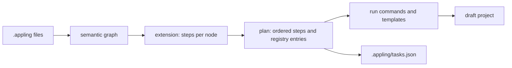

Code generation turns your model into a draft project for a target framework, such as Django or Ash. It runs once per project: it creates a new project in an empty folder and never overwrites one. Everything the generator cannot translate becomes a task in the project's [task registry](registry.md), so the draft never hides open work behind placeholders.

Generation goes through installable extensions. Each extension is a map from model elements to steps; the core plans the steps, runs them and writes the registry. Two extensions ship with Appling:

| Extension | Target |
|---|---|
| [`@appling/codegen-django`](django.md) | Django 6.1 with uv, REST framework for interfaces |
| [`@appling/codegen-ash`](ash.md) | Ash 3 on Elixir with AshPostgres, created through Igniter |

You can write your own; see [writing an extension](extensions.md).

## How it works



1. The CLI loads every `.appling` file as one workspace and validates it. A model with errors is not generated.
2. It builds the [semantic graph](../reference/graph.md): one node per element, identified by its qualified name.
3. For every node, the extension returns the steps that produce it.
4. The plan orders the steps and records one registry entry per node.
5. The runner executes the steps into the output folder and writes the registry.

## Configure targets

Targets live in `appling.config.json` in the folder where you run the CLI, under `generate`. Each target names an extension package and an output folder:

```json
{
  "generate": [
    { "extension": "@appling/codegen-django", "out": "build/shop", "options": { "name": "shop" } }
  ]
}
```

| Key | Meaning |
|---|---|
| `extension` | The extension package, resolved from the folder of `appling.config.json`. Install it there with your package manager. |
| `out` | The output folder, relative to that folder. It must be empty or missing. |
| `options` | Options for the extension. `name` sets the project name; without it, the project is named after the output folder. |

You can list several targets; they run in order, and the first one that fails stops the run. See [configuration](../reference/configuration.md) for the whole file.

## Preview the plan

`appling generate --plan` prints every step without running anything. It does not check prerequisites and does not touch the output folder, so it is safe to run at any time. This is an excerpt of the plan for the [example models](../../examples/sales.appling) with the Django target:

```sh
$ appling generate --plan examples
@appling/codegen-django -> build/shop
  (project): command: uv init --bare --name shop
  (project): command: uv add django~=6.1.0 djangorestframework~=3.16
  (project): command: uv run django-admin startproject config .
  (project): template: config/settings.py
  crm: command: uv run python manage.py startapp crm
  crm: template: config/settings.py
  sales: command: uv run python manage.py startapp sales
  sales: template: config/settings.py
  crm.Account: template: crm/models.py
  crm.Account.policy[read]: template: crm/tests.py
  sales.OrderStatus: template: sales/enums.py
  sales.Line: template: sales/values.py
  sales.Order: template: sales/models.py
  ...
  sales.PublicApi: template: sales/api.py
  sales.PublicApi: template: sales/urls.py
  sales.PublicApi: template: config/urls.py
  (project): command: uv run python manage.py makemigrations
70 element(s): 45 generated, 15 partial, 10 todo
```

Each line names the node that produced the step; `(project)` marks setup steps that run once. The last line counts the registry entries by status.

## Generate

```sh
appling generate [files or folders...]
```

For each target, `appling generate`:

1. Checks the extension's prerequisites, such as `uv` or Elixir, and prints a hint for each missing tool.
2. Refuses to run when the output folder exists and is not empty.
3. Runs the steps in order, printing one line per step.
4. Writes the registry to `.appling/tasks.json` in the output folder and prints the summary.

The exit code is 0 when every target succeeded and 1 otherwise. See the [CLI reference](../tools/cli.md#generate).

> [!WARNING]
> The first command that fails stops the run, before the registry is written. The output folder then holds a half built project, and the next `appling generate` refuses to write into it. Delete the folder, fix the cause (usually a missing tool or no network), and run again.

To carry later model changes into a generated project, use `appling generate --migrate`; see [migrations](migrations.md).

## Step kinds

An extension answers every node with a list of steps of three kinds:

| Step | Does |
|---|---|
| `command` | Runs the framework's own command line tool, such as `manage.py startapp` or `mix ash.gen.resource`. It runs without a shell, in a folder relative to the output folder that is created when missing. |
| `template` | Writes or patches one file relative to the output folder. It receives the current content, so many steps can add to the same file. |
| `task` | Records work the generator cannot do. It never runs; it becomes an open task in the registry entry of its node. |

Extensions prefer the framework's own generators and patch their output, so the draft looks like a project a developer of that framework would create.

## Order and phases

Steps run in a fixed order:

1. Setup steps of the extension, which create the project.
2. The steps of every node, by layer: modules first, then domain, cross cutting (roles, actors, tenants), behavior, application, interfaces and experience. Within a layer, nodes keep their order in the model.

A step can carry a `phase`. All steps of phase 0 run first, then phase 1, and so on; within a phase the order above holds. Later phases are for work that needs every element of an earlier one: Ash adds relationships in phase 1, once every resource exists, and both built in extensions create the initial database migrations in the last phase, after every model file is complete.

## What each element becomes

The registry has one entry per graph node, with a status:

| Status | Meaning |
|---|---|
| `generated` | The extension produced the element completely, or a parent's steps cover it. |
| `partial` | The element was generated, with open tasks. |
| `todo` | Nothing was generated; the entry holds only tasks. |

An extension returns no steps at all for a kind it does not handle. That node becomes a `todo` entry with the task `<extension> does not generate <Kind> yet`. Neither built in extension maps the experience layer, so pages, navigation, flows and messages are always `todo` entries: the registry carries them as open work with their model context. The same holds for actors and tenants.

Read [the registry](registry.md) for the entry format and how to work through it.
