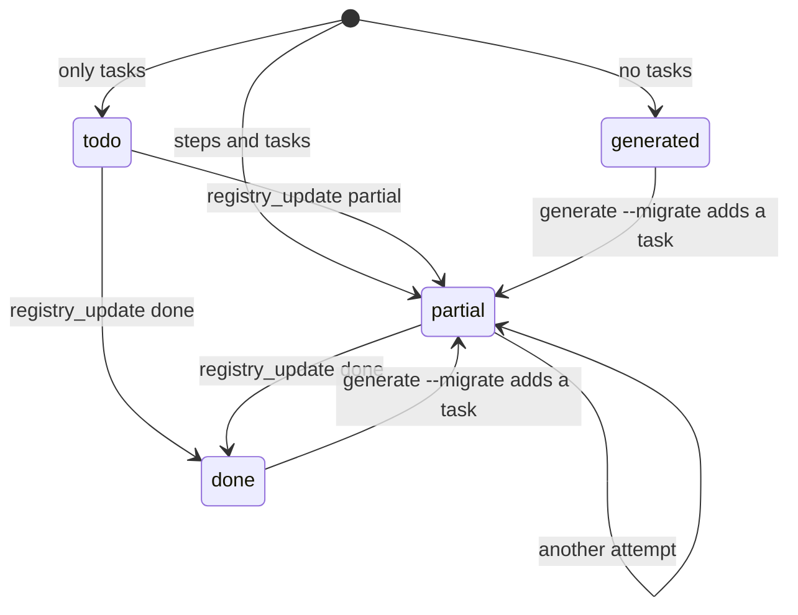

Every generated project gets a task registry in `.appling/tasks.json`. It has one entry per element of the model, keyed by qualified name, with what produced the element and what is still missing. The registry is two things at once: the coverage report of the generator and the work queue for you or an AI assistant.

Generation never leaves placeholders in the code. Work the generator cannot translate, such as a policy, a guard it cannot express, or a test body, is listed in the registry and nowhere else.

## File format

```json
{
  "extension": "@appling/codegen-django",
  "test": ["uv", "run", "python", "manage.py", "test"],
  "entries": {
    "sales.ExpireDrafts": { "qn": "sales.ExpireDrafts", "kind": "Job", "status": "partial", "...": "..." }
  }
}
```

| Field | Meaning |
|---|---|
| `extension` | The extension that generated the project |
| `test` | The command that runs the project's tests, from its root |
| `entries` | One entry per graph node, keyed by qualified name, in plan order (modules, then layer by layer) |

## Entries

This is the entry of the scheduled job `ExpireDrafts` from the [example model](../../examples/sales.appling), generated for Django:

```json
{
  "qn": "sales.ExpireDrafts",
  "kind": "Job",
  "layer": "behavior",
  "status": "partial",
  "steps": [
    "template: sales/jobs.py",
    "template: sales/management/__init__.py",
    "template: sales/management/commands/__init__.py",
    "template: sales/management/commands/expire_drafts.py",
    "task: schedule \"python manage.py expire_drafts\" with cron \"0 3 * * *\""
  ],
  "files": [
    "sales/jobs.py",
    "sales/management/__init__.py",
    "sales/management/commands/__init__.py",
    "sales/management/commands/expire_drafts.py"
  ],
  "missing": [
    {
      "what": "schedule \"python manage.py expire_drafts\" with cron \"0 3 * * *\"",
      "context": {
        "props": {
          "schedule": "0 3 * * *",
          "filter": "status == draft && created_at < now - duration(\"720h\")"
        },
        "related": [
          { "qn": "sales.Cancel", "kind": "Action", "edge": "action" },
          { "qn": "sales.Order.status", "kind": "Field", "edge": "uses" },
          { "qn": "sales.OrderStatus.draft", "kind": "EnumLiteral", "edge": "uses" },
          { "qn": "sales.Order.created_at", "kind": "Field", "edge": "uses" }
        ]
      }
    }
  ]
}
```

| Field | Meaning |
|---|---|
| `qn`, `kind`, `layer` | The element, as in the [semantic graph](../reference/graph.md) |
| `status` | `generated`, `partial`, `todo` or `done` |
| `steps` | Every step the extension returned for the element, one line each, tasks included |
| `files` | The files written by its template steps and the files its commands create |
| `missing` | The open tasks. Each has `what` to do and the model `context`: the element's properties and its related elements, with the edge that relates them. Incoming references read as `<edge> by`, such as `type by`. |
| `attempts` | How often someone recorded work on the entry (added by the registry tools) |
| `notes` | What they noted, such as what is left and why |

The context makes each task self contained: whoever picks it up sees the condition, schedule or type from the model and the elements it touches, without reading the whole model first.

## Status

The generator sets the first status from the steps of each element:

| Status | When |
|---|---|
| `generated` | The element has no tasks. This includes elements a parent covers, such as enum values written with their enum. |
| `partial` | The element has template or command steps and tasks. |
| `todo` | The element has only tasks, or the extension does not handle its kind. Then the task reads `<extension> does not generate <Kind> yet`. |
| `done` | Set later, when the open work is finished. |



Recording `done` clears `missing`. [`appling generate --migrate`](migrations.md) adds a task to the entry of every element a migration step changed and sets it back to `partial`.

## Coverage

Because every graph node has an entry, the registry doubles as a coverage report. `appling generate` and `appling generate --plan` print the counts:

```text
70 element(s): 45 generated, 15 partial, 10 todo
```

To list the open work yourself, filter the entries, for example with `jq`:

```sh
jq -r '.entries[] | select(.status == "todo" or .status == "partial") | "\(.qn): \(.missing[].what)"' build/shop/.appling/tasks.json
```

## Test skeletons

Rules get test skeletons: invariants, policies, transitions and the preconditions of actions. Each case is a skipped test whose skip reason points at the registry entry, so open work also shows up in every test run:

```python
class OrderTotalNeverNegativeTest(TestCase):
    """sales.Order.invariant["total never negative"]: total >= 0"""

    def test_holds_for_valid_rows(self):
        self.skipTest("registry task: sales.Order.invariant[\"total never negative\"]")
```

```elixir
@tag skip: "registry task: sales.Order.invariant[\"total never negative\"]"
test "invariant total never negative holds for valid records"
```

Writing the bodies is a task of the same entry, for example `write the test bodies of OrderTotalNeverNegativeTest in sales/tests.py`. When you write a test, remove its skip.

## Working through the registry

You can work through the entries by hand: pick an open entry, read its context, implement what is missing, run the tests and set the status to `done`.

The AI tools automate that loop. The Appling MCP server (`appling-mcp`) offers three registry tools, and the `appling-registry` skill describes the workflow for an agent. See [AI tools](../tools/ai.md) for the setup.

| Tool | Does |
|---|---|
| `registry_next` | Returns the next open entry in plan order (a `todo` or `partial` entry with tasks and attempts left), with its context and files. Takes an optional `target`, the output folder; the default is the first target in `appling.config.json` with a registry. |
| `registry_update` | Records the outcome for a qualified name: `done`, `partial` or `todo`, with an optional note. Every call counts as one attempt. |
| `run_tests` | Runs the registry's `test` command in the project and returns whether it passed, with the end of the output. |

The agent repeats: take the next entry, read the generated files and the element's Appling source, implement what is missing, run the tests until they pass, then record `done`. When it cannot finish, it records `partial` with a note on what is left.

After three attempts without `done`, an entry stops coming back from `registry_next`, and a note `stopped after 3 attempts` is added. The notes are what the next person reads. Decisions only a person can make, such as credentials or product choices, belong in such a note.
