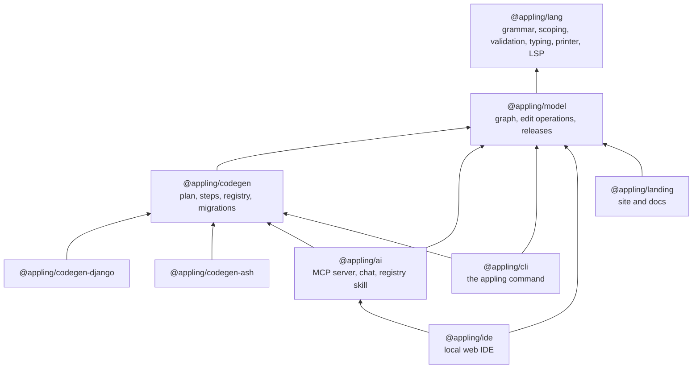
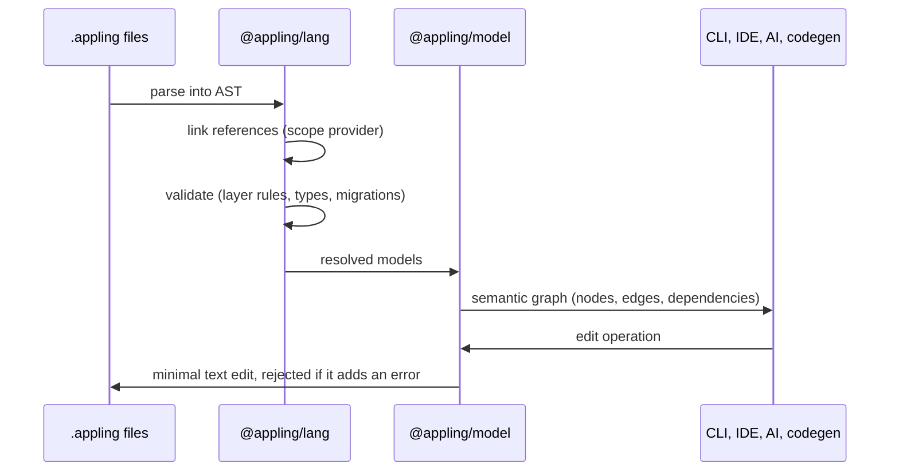

Everything in Appling reads the same resolved semantic graph and changes the model through the same edit operations. The language comes first, the graph and edits on top of it, and every tool on top of those.

## Packages

| Package | Role |
|---|---|
| `@appling/lang` | The grammar (`src/appling.langium`, built with [Langium](https://langium.org)), the scope provider, the validator with the layer rules, the expression typer, the canonical printer and the language server |
| `@appling/model` | Turns resolved models into the serializable [semantic graph](../reference/graph.md); applies [edit operations](../reference/edit-operations.md) as minimal text edits; writes release snapshots and migration steps |
| `@appling/codegen` | The extension contract, planning in layer order, the step runner, the task registry and migration planning |
| `@appling/codegen-django`, `@appling/codegen-ash` | Extensions: a map from graph node kinds to commands, templates and tasks |
| `@appling/ai` | The workspace `Project`, tool definitions shared by the MCP server and the IDE chat, and the registry skill |
| `@appling/cli` | `check`, `fmt`, `graph`, `release`, `generate` |
| `@appling/ide` | A server (snapshot, file, edit, chat endpoints, a language server per websocket) and a React client with Monaco, React Flow and ELK |
| `@appling/landing` | The Astro site, which also renders `docs/` |

Extensions read only `GraphNode.data`, never the Langium AST. That keeps third party extensions independent of the grammar's internals.

## From text to graph

## Mechanics that span packages

**Identity.** Elements are identified by qualified name; there are no ids. Unnamed elements get a key derived from their content. A rename is followed through migration steps once a release exists.

**Scoping.** Inside a module, nested elements are visible by dotted path (`Order.status`). Across modules and files, only exported members are visible, by module path (`sales.Order`). The scope provider special cases projection picks, query sort fields, `set` targets and error handlers.

**Layer rules.** `LAYER_OF` assigns every top level declaration a layer, and the validator checks every cross reference against the reference DAG of the [design concept](../concept.md). A new declaration kind must be added to `LAYER_OF`.

**Expressions.** A CEL subset parsed into plain AST nodes. Names inside expressions are strings, not cross references: the `ExpressionTyper` resolves them per position, types them and records the element each name stands for. The validator reports its problems, the graph turns the targets into `uses` edges, and rename follows them.

**Edit operations.** `applyEdit` finds the target by qualified name and splices text. Rename and retype touch only tokens; add, remove and set reprint the touched element canonically with `printRange`. The result is rebuilt and rejected if it adds an error. Rename must find every place that names an element, including names that are not references (export lists, message keys, transition states).

**Releases.** `appling release` writes the graph to `.appling/releases/<version>.json`. Later edits to released domain elements append `rename`, `retype` or `remove` steps to the module's `since_v<version>` block, which code generation carries into generated projects.

**Canonical printer.** Walks the concrete syntax tree and decides every gap between tokens, keeping comments. Which nodes open indented blocks and which keywords start their own line is configured in two sets, so new grammar constructs must be registered there.

**Graph nodes.** Only the element kinds listed in `NAMED`, plus unnamed elements with a content key, become graph nodes. Everything else folds into the props of its element. A new element kind must be added to one of the two.

## Adding a language construct

A grammar change ripples through several places. In order:

1. The grammar rule, and the keyword in the `Ident` rule if it should stay usable as a name.
2. `LAYER_OF` for a new top level declaration.
3. Scoping, if references need a special scope.
4. A branch in the expression typer's context function, if the construct holds expressions.
5. The printer's block and clause sets.
6. `NAMED` or a content key in the graph.
7. Rename splices, if the construct names elements by string.
8. A negative fixture per new validation rule, the README of `@appling/lang`, and [the language docs](../language/overview.md).
