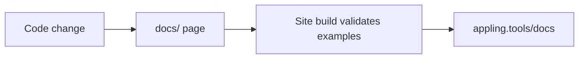

This documentation lives in the `docs/` folder of the repository. Each page is a Markdown file that reads well on GitHub, and the landing site renders the same files at [appling.tools/docs](https://appling.tools/docs/). There is one source and no copy.

## Pages

A page is `docs/<section>/<name>.md` and is published at `/docs/<section>/<name>/`. It starts with frontmatter and has no `#` heading, since the site prints the title:

```markdown
---
title: Domain layer
description: One sentence, used as the subtitle and the meta description.
---

An intro paragraph, then `##` sections. The table of contents on the right lists `##` and `###`.
```

The sidebar order is the `SECTIONS` list in `packages/landing/src/docs.ts`. A new page needs an entry there and in `packages/landing/public/sitemap.xml`; the build fails when `docs/` and `SECTIONS` disagree.

Link other pages by their relative file path, such as `[the CLI](../tools/cli.md#generate)`. The site turns these into page URLs, and links to other files in the repository into GitHub links, so the same Markdown works in both places.

## Validated examples

Appling code fences come in three kinds:

| Fence | Does |
|---|---|
| ```` ```appling ```` | Highlighting only, for fragments |
| ```` ```appling check ```` | A complete model. The site build validates it and fails on any error |
| ```` ```appling graph ```` | Validated, and the site draws its semantic graph below the code |

A graph example renders like this:

```appling graph
module billing {
  export Invoice

  entity Invoice {
    number: String unique
    total: Money
  }

  event InvoiceIssued {
    invoice: Invoice
  }

  action Issue on Invoice {
    effect {
      emit InvoiceIssued { invoice = this }
    }
  }
}
```

Because the build checks every `check` and `graph` example against the current language, a grammar or validation change that breaks an example is caught before it is published.

## Diagrams and callouts

Mermaid fences become diagrams with the site theme, and GitHub renders them too:



GitHub alerts become callouts:

> [!NOTE]
> Use `> [!NOTE]`, `> [!TIP]`, `> [!IMPORTANT]`, `> [!WARNING]` or `> [!CAUTION]`, sparingly.

## Style

- Short, direct sentences in the present tense. Address the reader as "you" in guides.
- No dashes between words or clauses, and no hyphenated compounds in prose: "cross cutting", "built in", "read only".
- Tables for mappings and options, prose for concepts, one runnable example per concept.
- Describe what the code does. Read the source before documenting a flag, keyword or output, and paste real output from the CLI.

## Keeping docs current

A change to anything a user can see updates the pages that describe it in the same commit: commands and flags, keywords and validation rules, the graph, edit operations, configuration, generated code, MCP tools, IDE features and public exports. Package READMEs and the docs cover the same ground and must agree.

For AI assistants working in the repository, `.claude/rules/documentation.md` maps each source path to the pages it feeds and loads automatically when those files are touched, and the `documentation` skill in `.claude/skills/` describes this page format.

## Building the site

```sh
pnpm --filter @appling/landing... build
```

This builds `@appling/lang` and `@appling/model` first, because the site uses them to validate examples and draw graphs, then the site into `packages/landing/dist`. Every push to `main` deploys it.
