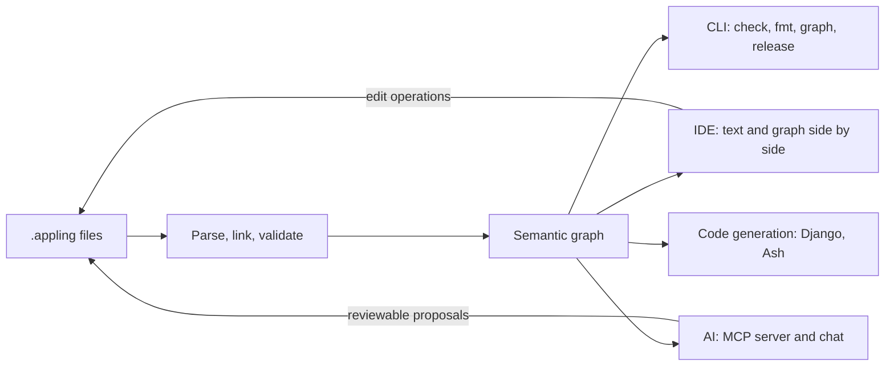

Appling is a declarative language for business applications. You write `.appling` files that describe what exists, what can happen, how capabilities are organized, how programs reach them and how people use them. Appling parses and links those files into one validated model, and every tool works on that model: the CLI, the IDE with its model canvas and search, the AI assistants and the code generators.

The text is the single source of truth. The graph you see, the edits the AI proposes and the project the generator writes all come from it and go back to it.

```appling graph
module sales {
  export Order

  enum OrderStatus {
    draft
    placed
  }

  entity Order {
    reference: String unique
    status: OrderStatus state default draft
  }

  action PlaceOrder on Order {
    requires { reference != "" }
  }

  machine OrderFlow on Order.status {
    transition draft -> placed via PlaceOrder
  }
}
```

## How it fits together



Every change, whether you type it, drag it in the graph or accept it from the AI, is an edit of the text. Edits are validated before they land, so the model never holds an error you did not write yourself.

## The model in five layers

Each concept is defined once, in the layer that owns it. References only point down the layers, and modules only see what other modules export.

| Layer | Describes | Declarations |
|---|---|---|
| Cross cutting | Modules, identity and access, evolution | `module`, `role`, `actor`, `tenant`, `migration` |
| L1 Domain | What exists | `enum`, `value`, `entity`, `invariant`, `policy` |
| L2 Behavior | What can happen | `event`, `action`, `machine`, `job` |
| L3 Application | How capabilities are organized | `query`, `projection`, `external`, `usecase` |
| L4 Interfaces | How programs reach them | `interface` |
| L5 Experience | How people reach them | `page`, `navigation`, `flow`, `messages` |

## What you can do with it

- **Validate** the whole model on every build: references, types, layer rules, exports and migrations. See [the CLI](tools/cli.md).
- **Explore and edit** it in [the IDE](tools/ide.md): the text with a language server next to a map of modules and entities, and a search over every element.
- **Work with AI** through [the MCP server or the IDE chat](tools/ai.md). AI changes pass the same validation and arrive as reviewable diffs.
- **Generate** a draft [Django](codegen/django.md) or [Ash](codegen/ash.md) project, or the domain and behavior layers as [Go](codegen/go.md) packages or a [Rust](codegen/rust.md) crate. What the generator cannot write becomes a task in a [registry](codegen/registry.md) for you or an AI.
- **Evolve** it safely: once you cut a [release](language/migrations.md), renames and type changes of stored data are recorded as migration steps and [carried into generated projects](codegen/migrations.md).

## Where to go next

| If you want to | Read |
|---|---|
| Install the tools | [Installation](getting-started/installation.md) |
| Write and check a first model in ten minutes | [Your first model](getting-started/first-model.md) |
| Derive a model from an application you already have | [Start from an existing project](getting-started/existing-project.md) |
| Learn the language | [Language overview](language/overview.md) |
| Generate a project | [Code generation](codegen/overview.md) |
| Look something up | [CLI](tools/cli.md), [configuration](reference/configuration.md), [semantic graph](reference/graph.md) |
| Understand the design | [Design concept](concept.md) |
