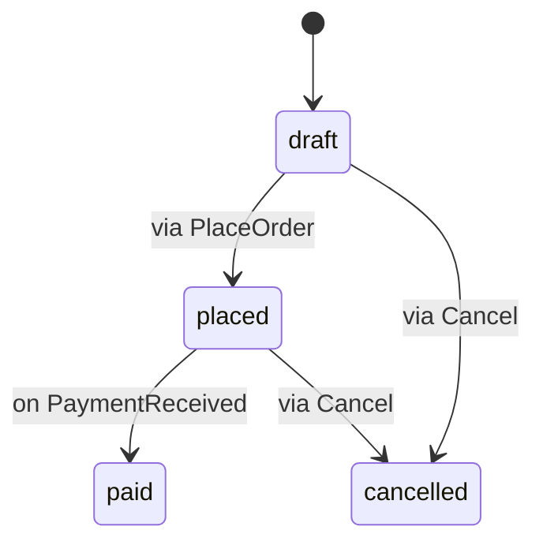

The behavior layer (L2) describes what can happen to the data and how it changes over time. Its declarations reference the [domain layer](domain.md) and cross cutting declarations, never the layers above. Its keywords are `event`, `action`, `machine` and `job`.

The examples on this page use this order model from [sales.appling](../../examples/sales.appling):

```appling
enum OrderStatus {
  draft
  placed
  paid
  cancelled
}

entity Order {
  lines: Line[] owned
  status: OrderStatus state default draft
  created_at: DateTime
  placed_at: DateTime?
  paid_at: DateTime?
}
```

## Events

An event is something that happened, with typed fields. Actions and transitions emit events; transitions, jobs and use cases react to them.

```appling
event OrderPlaced {
  order: Order
}
```

Event fields follow the [field syntax](domain.md#fields) of entities.

## Actions

An action is an operation on the data: create, update, delete or anything custom. `on <Entity>` binds it to one entity; an action without `on` stands alone.

The parts of an action come in a fixed order, each optional:

| Clause | Meaning |
|---|---|
| `input { name: Type ... }` | Typed inputs the caller passes |
| `requires { condition } else Error` | Preconditions, any number |
| `effect { ... }` | What the action changes |
| `errors A, B` | The errors the action declares |
| `consistency atomic` or `consistency eventual` | The transaction boundary of the action |
| `policy { condition }` | Action level access policies, any number |

```appling
action PlaceOrder on Order {
  requires { lines.size() > 0 } else EmptyOrder
  effect {
    set placed_at = now
  }
  errors EmptyOrder
  consistency atomic
  policy { actor.is(Customer) && customer == actor.account }
}

action Cancel on Order {
  input {
    reason: String?
  }
  policy { actor.is(crm.Clerk) }
}
```

### Inputs

Inputs are parameters: a name and a type, with `[]` and `?` as for fields. An optional input (`reason: String?`) may be left out by the caller. Inputs have no defaults.

### Preconditions

`requires { condition }` must hold for the action to run. `else <Error>` names the error raised when it does not; the error must be listed in the action's `errors`.

A precondition can read the fields of the action's entity, `this`, the action's inputs, `actor`, `now` and `tenant`.

A rule that must always be true belongs to the entity as an [invariant](domain.md#invariants), not to an action.

### Effects

| Effect | Meaning |
|---|---|
| `set field = value` | Assigns a field of the action's entity |
| `create Entity { a = x, b = y }` | Creates a record of an entity, assigning its fields |
| `emit Event { a = x }` | Emits an event, assigning its fields; the braces are optional |

Each value is an expression typed against the field it is assigned to. In `create` and `emit`, every assigned name must be a field of the entity or event: `Closed has no field "nope".`

A `set` effect cannot change a `state` field. Only a machine transition changes it: `A state field changes only through a machine transition.`

### Errors

`errors` declares the errors of the action by name. Preconditions refer to them with `else`, and [use cases](application.md#use-cases) handle them with `on <Error> do`. Each error has a qualified name, such as `sales.PlaceOrder.EmptyOrder`.

### Calling an action

When a use case calls an action, an action on an entity takes the entity first, then its inputs in order: `Cancel(order)` or `Cancel(order, "late")`. Optional inputs may be left out.

## Machines

A machine owns the transitions of one `state` field. It names the field by its path, `Entity.field`, and lists transitions.

```appling
machine OrderFlow on Order.status {
  transition draft -> placed via PlaceOrder effect { emit OrderPlaced { order = this } }
  transition placed -> paid on PaymentReceived
  transition draft, placed -> cancelled via Cancel when { !has(paid_at) }
}
```



| Part | Meaning |
|---|---|
| `transition a, b -> c` | Moves from any of the listed states to the target state |
| `via Action` | The action that triggers the transition |
| `on Event` | The event that triggers the transition (instead of `via`) |
| `when { guard }` | A Bool condition that must hold; it reads the fields of the machine's entity |
| `effect { ... }` | Effects that run with the transition, as in actions; `set` assigns fields of the machine's entity |

Every transition has exactly one trigger, `via` or `on`.

The rules a machine must follow:

- The field must be an entity field marked `state` with an enum type: `A machine must govern an entity field marked "state" with an enum type.`
- Each state field has at most one machine: `State field status is already owned by another machine.`
- Every state in a transition must be a value of the enum: `"closed" is not a value of Status.`

## Jobs

A job runs an action asynchronously, on a schedule or when an event happens.

```appling
job ExpireDrafts every "0 3 * * *" run Cancel where { status == draft && created_at < now - duration("720h") }
job NotifyCustomer on OrderPlaced run Notify
```

| Part | Meaning |
|---|---|
| `every "<schedule>"` | Runs on a schedule, such as a cron expression |
| `on Event` | Runs when the event is emitted (instead of `every`) |
| `run Action` | The action the job runs |
| `where { filter }` | Selects the records to run the action on; it reads the fields and inputs of the run action |

## Complete example

```appling check
module sales {
  role Customer

  enum OrderStatus {
    draft
    placed
    paid
    cancelled
  }

  entity Order {
    lines: Int
    status: OrderStatus state default draft
    created_at: DateTime
    placed_at: DateTime?
    paid_at: DateTime?
  }

  event OrderPlaced {
    order: Order
  }
  event PaymentReceived {
    order: Order
  }

  entity Notice {
    order: Order
    text: String
  }

  action PlaceOrder on Order {
    requires { lines > 0 } else EmptyOrder
    effect {
      set placed_at = now
      create Notice { order = this, text = "placed" }
    }
    errors EmptyOrder
    consistency atomic
    policy { actor.is(Customer) }
  }

  action Cancel on Order {
    input {
      reason: String?
    }
  }

  machine OrderFlow on Order.status {
    transition draft -> placed via PlaceOrder effect { emit OrderPlaced { order = this } }
    transition placed -> paid on PaymentReceived effect { set paid_at = now }
    transition draft, placed -> cancelled via Cancel when { !has(paid_at) }
  }

  job ExpireDrafts every "0 3 * * *" run Cancel where { status == draft && created_at < now - duration("720h") }
}
```
