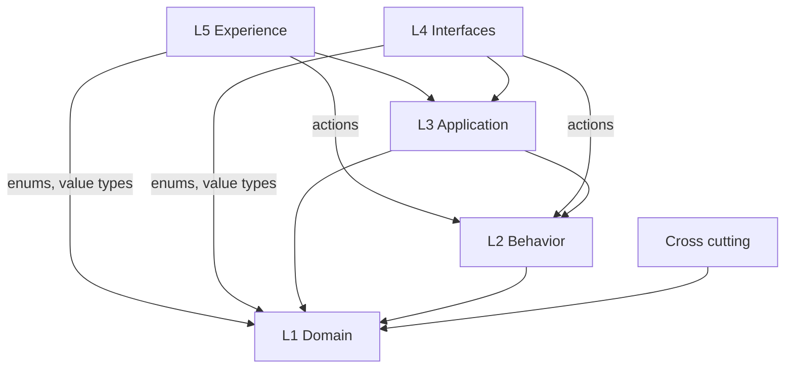

An Appling model is a set of `.appling` files. Each file holds one or more `module` blocks, and each module declares the parts of an application: data, behavior, application logic, interfaces and user experience. This page covers the syntax shared by all declarations and the rules that tie them together. The other language pages describe each layer in detail.

## Files and modules

A file contains only `module` blocks. Everything else lives inside a module.

```appling check
// Order management.
module sales {
  export Order

  enum OrderStatus {
    draft
    placed
  }

  entity Order {
    reference: String unique
    status: OrderStatus default draft
  }
}
```

All files you pass to `appling check` (or that the IDE opens) load as one workspace, so modules in different files can reference each other through their exports. See [modules](modules.md).

Inside a module, declarations appear in any order. A reference may point to a declaration that comes later in the file.

## Comments

| Form | Meaning |
|---|---|
| `// text` | Line comment |
| `/* text */` | Block comment |
| `/** text */` | Doc comment: a block comment right before a declaration. The language server shows it on hover, after the kind, qualified name and layer of the element. |

`appling fmt` keeps every comment and only normalizes the whitespace around it.

```appling check
module sales {
  /** An order placed by a customer. */
  entity Order {
    // Unique per customer, printed on the invoice.
    reference: String unique
  }
}
```

## Names and literals

Identifiers start with a letter or an underscore, followed by letters, digits or underscores: `Order`, `placed_at`, `_internal`.

Many keywords are also valid names, so fields such as `state`, `from` or `input` stay legal:

`state`, `input`, `value`, `from`, `to`, `on`, `for`, `step`, `list`, `detail`, `form`, `route`, `run`, `actions`, `fields`, `role`, `event`, `action`, `query`, `page`, `timeout`, `sort`, `when`, `create`, `read`, `update`, `delete`, `per`, `flow`, `actor`, `tenant`, `set`, `op`, `human`, `system`, `service`, `asc`, `desc`, `remove`, `rename`, `retype`, `roles`, `second`, `minute`, `hour`.

Every other keyword (`module`, `entity`, `machine`, `policy`, `true`, `null` and so on) is reserved.

| Literal | Form | Example |
|---|---|---|
| String | Double quotes, backslash escapes | `"Total"`, `"say \"hi\""` |
| Number | Digits with an optional fraction | `50`, `0.5` |
| Bool | `true`, `false` | `true` |
| Null | `null` | `null` |
| List | Square brackets | `[placed, paid]` |

Numbers have no sign; write `-1` as the unary minus applied to `1`. See [expressions](expressions.md).

## Canonical form

Every model has exactly one canonical text form: two space indentation, one declaration per line, clauses such as `effect` or `where` on their own line. `appling fmt` rewrites files into it, and the editor's format command does the same. Running it twice changes nothing.

## Layers

Each declaration belongs to exactly one layer. The keyword decides the layer: an `entity` is always domain, an `action` is always behavior, wherever it appears. Nested parts (fields, invariants, transitions, endpoints) belong to the layer of the declaration that contains them.

| Layer | Describes | Keywords | Page |
|---|---|---|---|
| Cross cutting | Structure and identity | `module`, `export`, `role`, `actor`, `tenant`, `migration` | [modules](modules.md), [access](access.md), [migrations](migrations.md) |
| L1 Domain | What exists | `enum`, `value`, `entity` with fields, `invariant`, `policy` | [domain](domain.md) |
| L2 Behavior | What can happen | `event`, `action`, `machine`, `job` | [behavior](behavior.md) |
| L3 Application | How capabilities are organized | `query`, `projection`, `external`, `usecase` | [application](application.md) |
| L4 Interfaces | How programs reach them | `interface <protocol>` with endpoints | [interfaces](interfaces.md) |
| L5 Experience | What people see | `page` with `list`, `detail`, `form`; `navigation`, `flow`, `messages` | [experience](experience.md) |

Each concept is defined once, in the layer that owns it, and referenced everywhere else. A rule that must always hold is an `invariant` on the entity (L1); a rule that must hold for one action to run is a `requires` precondition on that action (L2).

## Reference rules

References follow the layer order. Lower layers never reference higher ones, and interfaces and pages are siblings that never reference each other. The validator rejects every other edge.



| From | May reference |
|---|---|
| Any layer | Its own layer and cross cutting declarations |
| Cross cutting | L1 (an actor field of an entity type, a tenant on an entity) |
| L1 Domain | Nothing above it |
| L2 Behavior | L1 |
| L3 Application | L1, L2 |
| L4 Interfaces | L3, L2 actions, L1 enums and value types |
| L5 Experience | L3, L2 actions, L1 enums and value types |

L4 and L5 never reference an entity directly. They reach entity data only through L3 projections. Names inside expressions are not references in this sense; they resolve by position, as described in [expressions](expressions.md).

A rejected reference is reported as `<layer> element <Kind> may not reference <layer> element <Kind> "<name>".`, with the layers spelled `cross`, `domain`, `behavior`, `application`, `interface` and `experience`. Most reference positions accept only certain kinds of declarations anyway (an endpoint targets a query, an action or a use case), so the grammar already rules out many edges before this check runs.

## Qualified names

Every element is identified by its qualified name: the module path followed by the names of the declarations that contain it.

| Element | Qualified name |
|---|---|
| Module | `sales` |
| Nested module | `a.b` |
| Entity | `sales.Order` |
| Field | `sales.Order.status` |
| Enum value | `sales.OrderStatus.draft` |
| Action input | `sales.Cancel.reason` |
| Declared error | `sales.PlaceOrder.EmptyOrder` |
| External operation | `sales.Payments.Charge` |

There are no separate ids. Tools such as the [graph](../reference/graph.md), the [IDE](../tools/ide.md) and the [edit operations](../reference/edit-operations.md) address elements by these names, and renames are recorded as [migration steps](migrations.md) so tools can follow an element to its new name.

### Content keys of unnamed elements

Some elements have no name. Most examples below come from [sales.appling](../../examples/sales.appling). Unnamed elements get a key derived from their content, written in brackets after their kind.

| Element | Key | Example |
|---|---|---|
| Invariant | `invariant["<label>"]` | `sales.Order.invariant["total never negative"]` |
| Policy | `policy[<operations> fields <fields>]` | `sales.Order.policy[read fields total]`, `sales.Order.policy[create,update,delete]`, `sales.PlaceOrder.policy[]` |
| Transition | `transition[<from>-><to>]` | `sales.OrderFlow.transition[draft,placed->cancelled]` |
| Endpoint | `endpoint[<verb> <path>]` | `sales.PublicApi.endpoint[GET /orders]` |
| Set effect | `effect[set <field>]` | `sales.PlaceOrder.effect[set placed_at]` |
| Create effect | `effect[create <entity>]` | `sales.Reorder.effect[create Order]` |
| Emit effect | `effect[emit <event>]` | `sales.OrderFlow.transition[draft->placed].effect[emit OrderPlaced]` |

When two siblings share a key, an ordinal is appended to the second and later ones: `policy[read]#2`.

Other unnamed parts, such as preconditions, sort clauses, use case steps, page components or message entries, are not elements of their own. They are properties of the element that contains them.

## Language pages

| Page | Covers |
|---|---|
| [Modules](modules.md) | `module`, nested modules, `export`, references across modules and files |
| [Access](access.md) | `role`, `actor`, `tenant`, policies, `actor.is(...)`, narrowing |
| [Domain](domain.md) | `enum`, `value`, `entity`, field types and modifiers, `invariant`, `policy` |
| [Behavior](behavior.md) | `event`, `action`, `machine`, `job` |
| [Application](application.md) | `query`, `projection`, `external`, `usecase` |
| [Interfaces](interfaces.md) | `interface`, endpoints, auth, limits, CORS |
| [Experience](experience.md) | `page`, `list`, `detail`, `form`, `navigation`, `flow`, `messages` |
| [Expressions](expressions.md) | The CEL subset, typing, name resolution, builtins |
| [Migrations](migrations.md) | `migration`, `rename`, `retype`, `remove`, release blocks |
| [Validation](validation.md) | Every rule the validator enforces |
