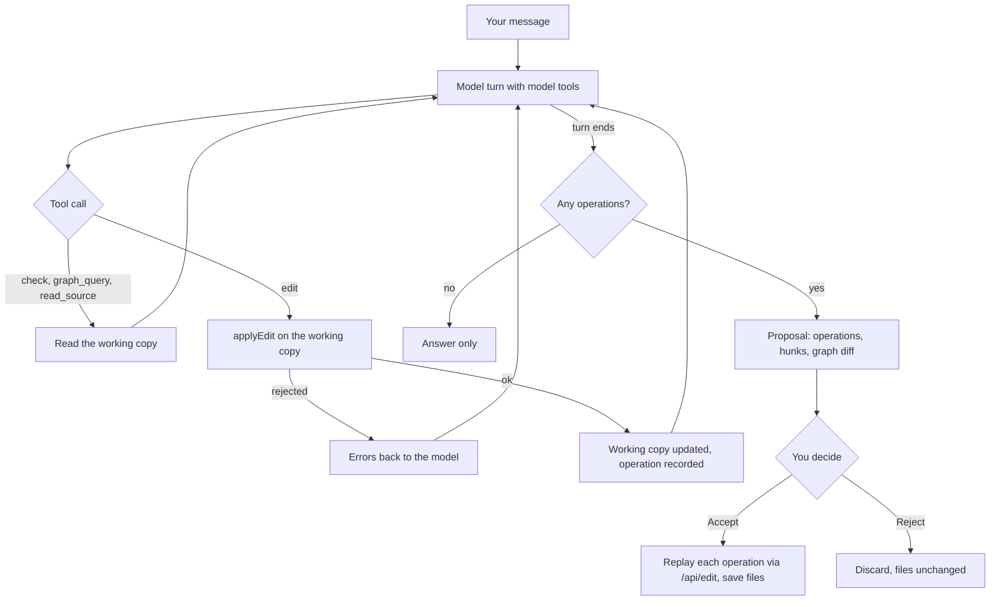

`@appling/ai` connects AI assistants to an Appling workspace. It has three parts:

- an [MCP server](#mcp-server), `appling-mcp`, with tools to query the model, edit it through validated operations and work through a generated project's task registry,
- the [appling skill and rules](#appling-skill-and-rules), which make a coding agent design and change the application through the model,
- the [registry skill](#registry-skill), instructions for an agent that finishes a generated project one task at a time,
- the [visualization window](#visualization-window), a floating window in which Claude Code shows you parts of the model, takes your questions and asks you to accept its changes,
- the [IDE chat](#ide-chat), which runs the same model tools on a working copy and returns its changes as a proposal you review.

An assistant never edits `.appling` text directly. It changes the model with [edit operations](../reference/edit-operations.md), and every operation is validated: an edit that does not parse or adds an error is rejected with the reasons, so the model stays valid.

## MCP server

```sh
npm install --save-dev @appling/ai
```

```sh
appling-mcp [folder]                  # stdio
appling-mcp [folder] --http [port]    # Streamable HTTP on http://127.0.0.1:<port>/mcp
```

| Argument | Default | Meaning |
|---|---|---|
| `folder` | the current folder | The workspace: every `.appling` file below it, plus `appling.config.json` and `.appling/releases/` in it |
| `--http [port]` | off; port `4411` | Serve Streamable HTTP instead of stdio. Put the folder before `--http`, since the argument after it is read as the port |

Over stdio, the server serves one client on stdin and stdout. Over HTTP, it listens on `127.0.0.1` only, answers on the path `/mcp`, accepts only the `Host` headers `127.0.0.1:<port>` and `localhost:<port>` (DNS rebinding protection), and handles every request statelessly.

The server sends Claude instructions that the model is the source of truth for business logic: questions about rules, states, actions, permissions and flows go to `graph_query`, `read_source` and `simulate` first, and the application code only for how something is implemented or what the model does not cover.

The server reads the files on every tool call, so it always sees the current text, including changes from the IDE or your editor. Edits it makes are written to the files at once.

### Claude Code

Add the server to the project (stdio):

```sh
claude mcp add appling -- npx appling-mcp .
```

Or start it over HTTP and point Claude Code at the address:

```sh
npx appling-mcp . --http 4411
claude mcp add --transport http appling http://127.0.0.1:4411/mcp
```

### Other MCP clients

Clients that start servers from a JSON configuration (such as Claude Desktop) take the command and its arguments. With `npx -p`, the package does not need to be installed:

```json
{
  "mcpServers": {
    "appling": {
      "command": "npx",
      "args": ["-p", "@appling/ai", "appling-mcp", "/path/to/your/project"]
    }
  }
}
```

Use an absolute folder here, since the client decides the working directory.

## Tools

The server registers twelve tools, and six more for the [visualization window](#visualization-window) over stdio or for the [canvas](#visual-tools-on-the-canvas) over the IDE server's `/mcp`. Each returns its result as JSON text.

### Model tools

These five tools are shared by the MCP server and the IDE chat.

| Tool | Input | Returns |
|---|---|---|
| `check` | none | `{ errors }`: one `file:line:column message` per error; an empty list means the model is valid |
| `graph_query` | `qn?`, `kind?`, `module?`, `search?` (all strings) | With `qn`: that [graph node](../reference/graph.md) with `contains`, `refersTo` and `referredBy`. Without: `{ count, elements }`, the nodes filtered by `kind` (such as `Entity`), `module` and a `search` text in the qualified name (case insensitive), at most 200 of them, each with `qn`, `kind` and `layer` |
| `read_source` | `qn` (string) | `{ source }`: the file name and the element's source text |
| `edit` | `operation` (object), `dryRun?` (boolean) | `{ ok: true, changed }` with the changed files, or `{ ok: false, errors }`. With `dryRun`, it validates without writing |
| `simulate` | `question`: `reach`, `actors`, `risks` or `run`; `machine?`, `state?`, `action?`, `record?`, `actor?`, `actorFields?`, `inputs?` | The [simulator](simulator.md)'s answer, with values it could not know as `"unknown"`; `{ error }` for an unknown element |

The `operation` of `edit` is one of the five [edit operations](../reference/edit-operations.md), chosen by `op`:

| `op` | Fields |
|---|---|
| `add` | `parent`: qualified name of the element to add to, such as `sales.Order`; `source`: Appling source of the new member, such as `note: Text?` |
| `rename` | `target`, `name` |
| `retype` | `target`: a field or parameter; `type`: Appling type, such as `Money` or `crm.Account[]` |
| `remove` | `target` |
| `set` | `target`; `property`: a property name as `graph_query` shows it, such as `default`, `condition` or `modifiers`; `value`: Appling source of the value, empty to remove the property |

An example call of `edit`:

```json
{ "operation": { "op": "rename", "target": "sales.Order.total", "name": "amount" } }
```

Edits are release aware: once the workspace has a release, renaming, retyping or removing a released domain element also appends a migration step. See [Edit operations](../reference/edit-operations.md#release-aware-edits).

### Authoring tools

| Tool | Input | Returns |
|---|---|---|
| `language_reference` | `page?` (string) | Without `page`: `{ pages }`, each with `page`, `title` and `description`. With `page`: `{ page, markdown }`, the full text of that page of the [language documentation](../language/overview.md); `{ error }` with the page names for an unknown page |
| `write_model_file` | `path`: a `.appling` path relative to the workspace; `source`: the complete file | `{ ok: true, written }`, or `{ ok: false, errors }` with the errors the file would add. A file is written only when the whole workspace still validates with it, and only inside the workspace |

`language_reference` serves the pages of this documentation's language section, shipped inside the package, so an assistant that has never seen Appling can learn the syntax before it writes any. `write_model_file` creates new modules, which the edit operations cannot, for example when [deriving a model](#reverse-engineering-skill) from an existing application.

### Registry tools

These three tools work on the [task registry](../codegen/registry.md) (`.appling/tasks.json`) of projects made by `appling generate`. The targets come from the `generate` section of `appling.config.json`, with each `out` folder taken relative to the workspace folder; targets without a registry are ignored.

| Tool | Input | Returns |
|---|---|---|
| `registry_next` | `target?`: output folder of a generate target, default the first one | `{ out, entry }`: the first entry in dependency order whose status is `todo` or `partial`, that has missing work and fewer than three attempts; or `{ done: "No open tasks." }` |
| `registry_update` | `qn` (string), `status` (`done`, `partial` or `todo`), `note?` (string), `target?` | The updated entry. It counts one attempt; `done` clears the missing work; the note is appended; an entry still open after its third attempt gets the note `stopped after 3 attempts` |
| `run_tests` | `target?` | `{ out, passed, output }`: runs the test command the extension recorded in the registry (for example `uv run python manage.py test`) in the project, with the last 4000 characters of its output |

The entry from `registry_next` carries everything an agent needs: the element's qualified name, kind and layer, the steps and files that produced it, and for each missing task its description with the element's properties and related elements.

### Reference tools

These two tools read and write the [code references](references.md) of the workspace (`.appling/references.json`): where each element is implemented, by file and line range.

| Tool | Input | Returns |
|---|---|---|
| `code_references` | `qn?` (string) | `{ references }`. With `qn`: the references of that element and its members. Without: every reference that is not `current`. Each has `qn`, `file`, `start`, `end`, `anchor` and `status` (`current`, `shifted`, `broken` or `orphaned`); a shifted one has the lines where its anchor is now and the `recorded` range |
| `record_code_references` | `qn` (string), `ranges`: a list of `{ file, start, end }`, with `file` absolute or relative to the workspace folder and lines counted from 1 | The recorded references, each with the first line of its range as `anchor`; `{ error }` for an unknown element, a missing file, a range outside the file or one that starts on an empty line. It replaces the element's references; an empty list removes them |

### The implement_next_task prompt

The server also registers the MCP prompt `implement_next_task`. It carries the text of the registry skill below, so a client that supports prompts can start the workflow without installing the skill.

## Appling skill and rules

The package ships the instructions that make a coding agent work model first:

| File | Loaded | Says |
|---|---|---|
| `rules/appling.md` | Always, from the agent's instructions | The model is the source of truth; every requirement goes through the model first; a design is a model, not code; the model changes only through the MCP tools; while only the model exists, changes apply without asking; once the code exists, model and code change together in both directions, through `appling generate --migrate` or `--sync` where generation covers the change and by hand otherwise; the work shows in the visualization window |
| `skills/appling/SKILL.md` | When a request is about what the application does | How to find out where the project stands, learn the language with `language_reference`, design a new application layer by layer, verify it with `simulate`, generate and release it, carry a change through model and code, and explain the application from the model |

Skills load only when the agent decides a request needs them; the rules are always in context and tell the agent to load the skill. [`appling init`](../getting-started/new-project.md) wires both into Claude Code, Codex, OpenCode, Gemini CLI and Antigravity CLI by reference into `node_modules/@appling/ai`, so updating the package updates them. To wire them by hand in Claude Code, import the rules in `CLAUDE.md` and link the skill:

```sh
echo '@node_modules/@appling/ai/rules/appling.md' >> CLAUDE.md
mkdir -p .claude/skills
ln -s ../../node_modules/@appling/ai/skills/appling .claude/skills/appling
```

## Reverse engineering skill

`skills/appling-reverse/SKILL.md` guides an agent from an existing application to an Appling model: learn the language through `language_reference`; survey where the code keeps its data model, rules, behavior, reads, access checks, interfaces and pages; map each to its Appling construct, with rules for access (every policy grants by role with conditions, every principal including unauthenticated visitors and code without an actor gets a role, grants taken from the call sites, nested writes); write one module per file with `write_model_file`, checking after each; mark what the business runs on as `core` and housekeeping modules as `peripheral` where the graph's own [relevance](../language/relevance.md) ranking misses it; record the code each element describes with `record_code_references`; compare the model's behavior with the code through `simulate`; and report what the model cannot say exactly, with comments that name the source files. The MCP prompt `derive_model` carries the same instructions. Install it like the registry skill, next to the MCP server pointed at the folder for the new model. [Start from an existing project](../getting-started/existing-project.md) walks through it step by step.

## Registry skill

The registry skill lives in the package at `skills/appling-registry/SKILL.md`. It tells an agent to repeat, until `registry_next` reports no open tasks:

1. Call `registry_next` for the next entry.
2. Read the generated files listed in it, `read_source` for the element and `graph_query` for related elements. The model is the specification; the agent does not change it to make the code easier.
3. Implement what is missing in the style of the code around it. For a test body, write the test and remove the skip that points at the entry.
4. Call `run_tests` and fix failures until the related tests pass.
5. Call `record_code_references` with every line range that implements the element, and now and then record again what `code_references` reports as shifted or broken.
6. Call `registry_update` with `done`, or `partial` with a note on what is left and why.

Entries that need a decision only a person can make (credentials, an external system's real behavior, product choices) end as `partial` with the question in the note. Effort follows the [relevance](../language/relevance.md) of the element: `core` declarations are implemented completely with tests for their rules, `peripheral` ones get the simplest correct implementation.

To install it for Claude Code, copy the folder into your project's skills folder, next to the MCP server:

```sh
mkdir -p .claude/skills
cp -r node_modules/@appling/ai/skills/appling-registry .claude/skills/
```

Then ask Claude Code to finish the generated project; the skill's description makes it load for requests about the task registry.

## Visualization window

Over stdio, `appling-mcp` can show the model in a window of its own while you talk to Claude Code in the terminal. Ask for it in words, such as "show me the order lifecycle" or "draw what PlaceOrder does", or ask how a part of the application works, such as "how does observability work": Claude calls `visualize`, and a frameless window opens at the top right of your main screen, above every other window, without taking the focus from the terminal. It closes with its close button or when the Claude Code session ends; the next `visualize` opens it again.

The window runs on [Electron](https://www.electronjs.org), which `@appling/ai` installs through `@appling/viz`. It works on macOS, Windows and Linux. The first window downloads the Electron binary once.

> [!NOTE]
> Linux Wayland sessions do not let an application keep a window on top or place it, so the window runs through XWayland there. It needs XWayland, which GNOME and KDE provide.

### Views

| View | Draws | `focus` takes |
|---|---|---|
| `node` | The [IDE](ide.md#the-model-canvas)'s model tree with only the focused declarations or modules: the trail from the seed through the module to each one, unfolded to what uses it. Its tabs switch the lens | Any declaration or module |
| `machine` | A flowchart: the states of the machine's field type as boxes, the initial one highlighted and the final ones double framed. The transitions stay hidden until you click a state; then its arrows show where it can go, one per transition, labelled with the action or event that drives it, its guard and the jobs that run it. Click the state again to hide them | Machines |
| `action` | One card: the states it moves between, whether each actor may run it (`yes`, `no` or `depends` on the data, from the [simulator](simulator.md)), its inputs, preconditions, changes, errors and the declarations that use it | Actions |
| `usecase` | A flowchart: the use case with its inputs, then its steps in order, with each error handler and timeout branching off its step to the call it makes | Use cases |
| `event` | One card: the fields, the actions that emit it, the transitions it triggers and the use cases that await it | Events |

Arrows run in straight segments with right angle corners. Click a node, an arrow label, a card title or a row to select the element behind it; the strip below the canvas shows its kind, members and related declarations, and clicking a related declaration draws it in its own view. The window follows the files: an edit from Claude, the IDE or your editor redraws it.

### One node at a time

The `node` view lets Claude walk you through the model. Each `visualize` with the `node` view adds to the tree on screen instead of replacing it: a declaration the tree already shows, such as one that uses the last node, unfolds where it is; any other one gets its own trail from the seed. A declaration the lens on screen cannot draw switches the tree to the lens of its kind. Another view replaces the tree.

### Bubbles

Claude explains what happens at an element with `visual_bubble`. A bubble points at the element, or at one of its members such as a field; when the view draws only the element, the bubble names the member. A code bubble carries a few lines of code that hint how the element is implemented, with the file and line they come from, such as a [code reference](references.md). A bubble whose element the view does not draw shows in the bottom left corner.

The canvas shows one bubble at a time, so none covers another. It grows as large as its text and code need, up to the width of the window, and shows the code in full. Its pointer leads to the element it is about, and that element is selected: highlighted in the view and described in the strip below the canvas. On the tree the camera glides to the element and leaves room for the bubble below it, so you see where the explanation moves; in a flowchart or on cards the view scrolls smoothly to it. Back and Next at the bottom of the bubble step through the explanation in Claude's order, with the step number between them. A row of numbered tabs above the canvas lists every bubble of the view, named after the element or member it points at, so you can also jump to one. The first bubble from Claude is shown; later ones join the tabs and the step count without moving you away from the bubble you are reading, and Next reaches them. Bubbles stay while the view stays, and through every `node` view that adds to the tree; another view clears them.

### Open code in your editor

Every file and line in the window is a link: in a code bubble, above each changed file of a proposal, and in Claude's answers (`shop/sales/models.py:14`). A click opens the file at that line in your editor, found by [launch-editor](https://github.com/yyx990803/launch-editor): the running editor, else the one in `LAUNCH_EDITOR`, `VISUAL` or `EDITOR`. Paths are relative to the model folder.

### Talk about what you see

When you say "this" or "the selected one" in the terminal, Claude reads your selection with `visual_selection`.

You can also type a question into the window. It reaches the session through [Claude Code channels](https://code.claude.com/docs/en/channels), and Claude answers in the window with `visual_reply`. Channels are a research preview, and a channel that is not on Anthropic's allowlist must be named at start:

```sh
claude --dangerously-load-development-channels server:appling
```

Here `appling` is the name of the server in your MCP configuration. Without the flag, everything else works, and questions typed into the window are dropped.

### Live changes and progress

The window follows the session as it works:

- **Progress.** Claude reports each step of a longer task with `visual_status`, such as "Modeling the tasks module" or "Implementing registry task 3 of 12". The strip below the title bar shows the current step with a progress bar when the step has a count; hovering it lists the earlier steps. The first status opens the window.
- **Changes in the tree.** Every change of a model file marks the declarations it touches in the `node` view: green for a declaration added in this session, amber for one whose members or properties changed. While the `node` view is on screen, or no view yet, the tree also grows by every declaration the session touched, so you watch the model take shape. Another view on screen stays as it is.
- **Session changes.** The dock lists every element added, removed and changed since the MCP server started, with the changed lines per file. Click an element to select it and open its view.

The changes count from the files as they were when the MCP server started, whoever changed them: Claude, the IDE or your editor.

### Review changes in the window

Claude changes the model with `edit` and the window shows the change as it happens. When you ask to review a change before it is written, Claude proposes it with `propose_edits`. The window shows the summary, the changed lines per file and the elements added, removed and changed. Accept writes the operations to the files; Reject leaves them unchanged and returns your optional comment to Claude. Closing the window rejects an open proposal.

### Visualization tools

| Tool | Input | Returns |
|---|---|---|
| `visualize` | `view`: `node`, `machine`, `action`, `usecase` or `event`; `focus`: qualified names; `title?`, `note?` | `{ shown: true }`, or `{ error }` naming the elements the view cannot draw |
| `visual_bubble` | `target`: an element or member; `text`; `code?`; `file?` (relative to the model folder) and `line?` | `{ placed: true }`, or `{ placed: false, reason }` for an unknown element, a missing file, a line without its file or a closed window |
| `visual_selection` | none | `{ open, qn?, view? }`: whether the window is open, the selected element and the view on screen |
| `visual_reply` | `text`, `ask_id?` | `{ sent: true }`, or `{ sent: false, reason }` when the window is closed |
| `visual_status` | `text`: the current step; `done?`, `total?`: the progress | `{ shown: true }`; opens the window when it is closed |
| `propose_edits` | `operations`: [edit operations](../reference/edit-operations.md); `summary` | After your decision: `{ accepted: true, ok: true, changed }`, `{ accepted: false, comment? }`, or `{ ok: false, operation, errors }` when an operation is invalid before review |

A question from the window arrives in the session as a channel message with the attributes `ask_id`, `selected` (the selected element) and `view` (the view and its focus).

## Agent sessions

Several coding agents can work on one repo, or on the repos of one workspace, at the same time. Each one runs in an agent session: a terminal of [Appling Desktop](https://github.com/alex20465/appling/tree/main/packages/desktop) with an identity that its MCP connection carries. Through the session tools an agent labels its session with what it is about, keeps its status current, claims the elements and files it works on, sees the other sessions with their claims and messages them. An edit that touches another session's claim still goes through but comes back with a warning.

### Connect an agent

The [IDE server](ide.md) of every repo serves the repo's MCP server over Streamable HTTP at `http://127.0.0.1:<port>/mcp`. Every request needs the bearer token of a session; a request without a known token gets `401`. Appling Desktop opens a session for every agent it starts and hands the agent the URL and the token. Without Desktop, open one with `POST /api/sessions` on the IDE server:

```sh
curl -s -X POST http://127.0.0.1:4410/api/sessions -d '{"name": "Claude Code"}'
# { "session": { "id": "...", "name": "Claude Code", "status": "working", ... }, "token": "...", "mcp": "http://127.0.0.1:4410/mcp" }
claude mcp add --transport http appling http://127.0.0.1:4410/mcp --header "Authorization: Bearer <token>"
```

`DELETE /api/sessions/<id>` ends a session, and its claims and token end with it. `PATCH /api/sessions/<id>` with `{ "label" }` renames it as the user. Every tool call of the connection is attributed to its session: the session records the last tool and when it ran.

The server instructions tell the agent to set the label after reading the first prompt, keep the status current, check the claims of the other sessions before it changes anything, claim what it works on, and settle conflicts by message.

### Session tools

| Tool | Input | Returns |
|---|---|---|
| `session_set_label` | `label`: a few words, such as `Invoice entity and its payment flow` | The session. The tab shows the agent's name until the label is set; the label stays until the agent or the user changes it |
| `session_set_status` | `status`: `working`, `blocked`, `needs-input`, `done` or `failed`; `note?` | The session |
| `session_claim` | `elements?`: qualified names; `files?`: paths, absolute or relative to the repo | `{ claims }`, with `conflicts` and a `warning` when other sessions claimed something that overlaps |
| `session_release` | `elements?`, `files?`; neither releases every claim | `{ claims }` |
| `sessions_list` | none | `{ self, others }`: the sessions of the workspace with label, status, note, repo, claims and last tool call |
| `session_message` | `to`: a session id or label; `text` | `{ sent: true, to }`, or `{ error }` for an unknown or ambiguous session |
| `session_inbox` | none | `{ messages }`: the unread messages, each with `from`, `fromLabel`, `text` and `at`; reading marks them read |
| `ide_context` | none | What the IDE shows: the session's `tab`, the `repo`, the `activeRepo` and `workspace`, the open `tabs`, the canvas `view`, the `selection` and the open `file` |
| `ide_act` | `action`: `focus`, `open`, `highlight` or `reveal`; `elements?`; `file?`, `line?` | `{ ok: true }`, or `{ ok: false, reason }`. `focus` shows the session's tab (Desktop only), `open` and `reveal` select an element or open a file, `highlight` marks elements on the canvas in the session's colour (an empty list clears them) |

A claim of an element covers its members, and a claim of a member touches its element: `sales.Order` and `sales.Order.status` overlap, `sales.Order` and `sales.OrderFlow` do not. Element claims count within one repo, file claims across the workspace.

When another session claimed what a tool call touches, `edit`, `propose_edits` and `write_model_file` return `conflicts` (`session`, `label`, `claimed`, `touched`) and a `warning`. The edit target, the parent of an `add`, and every file the edit changed count. Every tool result also carries `messages` while messages wait unread.

### Visual tools on the canvas

Over the IDE server's `/mcp`, every session also gets the visual tools (`visualize`, `visual_bubble`, `visual_selection`, `visual_reply`, `visual_status`, `propose_edits`), and they draw on the repo's canvas in the [IDE](ide.md#agent-views-and-proposals) instead of a floating window. The canvas never moves on its own: a session's view waits beside the canvas until the person opens it. `visual_selection` returns the element selected in the IDE, `open` while an IDE page is connected, and the session's view while the person looks at it. `propose_edits` waits until the person accepts or rejects the proposal in the app. Questions typed into the floating window reach a stdio session as a channel; the IDE has no such channel, so `visual_reply` there shows the answer with the session's view.

Every file a session's tool call writes is attributed to the session in the IDE's [live changes](ide.md#live-changes), which mark every change to the model, by a session or by anything else that writes the files.

### Where sessions live

The sessions sit in a session store that the IDE servers of a workspace share. Appling Desktop holds one store in its main process and serves it to every repo's IDE server child over the child's IPC channel (`appling-ide --shared-sessions`), so sessions of different repos see each other and keep their claims while a server restarts. A session belongs to a workspace and works in one repo; it sees the sessions of its workspace, or of its repo when it has none. An IDE server started on its own keeps a store of its own.

The IDE server pushes every change of the sessions over its `/events` websocket as `{ type: "sessions", sessions }`, and every `ide_act` except `focus` as `{ type: "act", session, color, action, ... }`. The IDE client reports what it shows (`{ type: "context", selection, view, file, watching }`) on the same socket, which `ide_context` returns, and draws the claimed and highlighted elements of its repo's sessions with a ring in the session's colour.

## The playbook

Sessions work in parallel, but the person follows one story at a time. Every workspace has one playbook: the chapters the sessions of all its repos write about what they plan and do, which the person plays on the canvas of the [IDE](ide.md#the-playbook) step by step. A session opens a chapter when it starts a piece of work, with its plan as ordered steps. Each step names the elements it adds, changes or removes, with a note. The person previews the planned steps and responds before the work is done. As the session works, it marks the steps done in the same chapter and closes the chapter with the result.

The playbook moves only when the person steps forward. A chapter opened while the person watches another one queues after it and never moves the canvas. The server instructions tell sessions to read the playbook first, to never interrupt, to append after the chapter being watched, and to name the earlier chapters they build on in `refs`.

### Playbook tools

| Tool | Input | Returns |
|---|---|---|
| `playbook_open_chapter` | `title`, `plan`; `steps?`: `[{ elements, change, note }]` with `change` one of `add`, `change`, `remove` or `show`; `refs?`: ids of earlier chapters | `{ chapter, watching, queued, unwatched }`: the chapter with numbered steps, and where the person is |
| `playbook_add_steps` | `chapter?`, `steps` | The same, with the steps appended |
| `playbook_step_done` | `chapter?`, `steps`: step numbers; `note?` | The same, with the steps marked done |
| `playbook_close_chapter` | `chapter?`, `result` | The same, with the chapter closed |
| `playbook_read` | none | `{ watching, queued, unwatched, chapters }`: the chapter and step the person watches (`null` when none), the unwatched chapters after it, and every chapter with its steps, states and the person's responses |

Without `chapter`, the tools write the session's last open chapter. A session writes only its own chapters; it reads all of them.

The person approves, rejects or comments on any step. The response is stored with the step, and while the session that wrote the chapter runs, it also lands in that session's inbox as a message from `User` (`from: "user"`), so the next tool result says a message waits.

### Where playbooks live

Appling Desktop holds the playbooks next to the sessions in its main process and serves them to every repo's IDE server over the same IPC channel. It keeps each workspace's playbook as a JSON file in the `playbooks` folder of the app's data folder, so playbooks outlive the sessions and the app. A session's playbook is the one of its workspace, or of its repo folder when it has none. An IDE server started on its own keeps its playbooks in memory.

The app writes chapters of its own, such as for a code generation run, without MCP, through `openChapter(store, author, chapter)` from `@appling/ai`. It returns a writer with `add(steps)`, `done(numbers, note?)`, `close(result)` and `read()`:

```ts
const chapter = await openChapter(ide.playbooks, { workspace, repo, label: 'Generate Django', color: '#1971c2' },
    { title: 'Generate the Django project', plan: 'One app per module', steps: [{ elements: ['sales.Order'], change: 'show', note: 'models.py' }] });
await chapter.done([1]);
await chapter.close('Generated 12 files');
```

## IDE chat

The AI tab of the [IDE](ide.md#the-ai-tab) runs one chat turn per message with the four model tools and a system prompt about Appling's layers. It uses the [AI SDK](https://ai-sdk.dev) and works with Anthropic and OpenAI models.

### Configure the model

Set the `ai` section of `appling.config.json` in the workspace folder:

```json
{
  "ai": { "provider": "anthropic", "model": "claude-opus-5-5" }
}
```

To use OpenAI, set `provider` to `openai` and `model` to an OpenAI model id.

| Key | Values | Default |
|---|---|---|
| `provider` | `anthropic` or `openai` | `anthropic` |
| `model` | A model id of that provider | `claude-opus-5-5` |

Each key falls back to its default on its own, so when you switch `provider`, also set a `model` of that provider. The settings are read on every chat turn; a change applies without restarting the IDE.

The API key comes from the environment of the IDE process, never from the configuration:

| Provider | Variable |
|---|---|
| `anthropic` | `ANTHROPIC_API_KEY` |
| `openai` | `OPENAI_API_KEY` |

A missing key or an unknown model shows up as an error in the chat turn.

### Proposals

The chat never writes your files. Each turn starts from the files on disk, and the assistant's edits go to a working copy, where they are validated like any edit. A turn may take up to 25 model steps. When it ends with at least one successful edit, it returns a proposal:

| Part | Content |
|---|---|
| `operations` | The edit operations in the order they were made |
| `hunks` | Per changed file, the first changed line and the removed and added lines |
| `graph` | The qualified names of the elements `added`, `removed` and `changed` (properties differ) |

You accept or reject the proposal in the IDE. Accepting replays the operations through the IDE's edit path, so each lands in the editor as an undoable step.



### Use the chat in your own tool

`chat(root, messages, model)` from `@appling/ai` runs one turn and yields events: `text` deltas, `tool` calls, at most one `proposal` at the end, and `error` messages. See [API](../reference/api.md).
