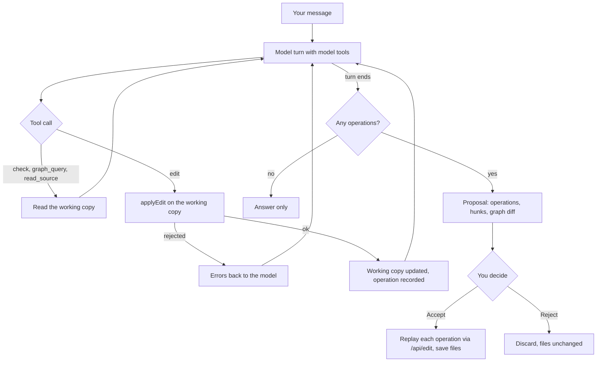

`@appling/ai` connects AI assistants to an Appling workspace. It has three parts:

- an [MCP server](#mcp-server), `appling-mcp`, with tools to query the model, edit it through validated operations and work through a generated project's task registry,
- the [registry skill](#registry-skill), instructions for an agent that finishes a generated project one task at a time,
- the [visualization window](#visualization-window), a floating window in which Claude Code shows you parts of the model, takes your questions and asks you to accept its changes,
- the [IDE chat](#ide-chat), which runs the same model tools on a working copy and returns its changes as a proposal you review.

An assistant never edits `.appling` text directly. It changes the model with [edit operations](../reference/edit-operations.md), and every operation is validated: an edit that does not parse or adds an error is rejected with the reasons, so the model stays valid.

## MCP server

```sh
npm install --save-dev @appling/ai
```

```sh
appling-mcp [folder]                  # stdio
appling-mcp [folder] --http [port]    # Streamable HTTP on http://127.0.0.1:<port>/mcp
```

| Argument | Default | Meaning |
|---|---|---|
| `folder` | the current folder | The workspace: every `.appling` file below it, plus `appling.config.json` and `.appling/releases/` in it |
| `--http [port]` | off; port `4411` | Serve Streamable HTTP instead of stdio. Put the folder before `--http`, since the argument after it is read as the port |

Over stdio, the server serves one client on stdin and stdout. Over HTTP, it listens on `127.0.0.1` only, answers on the path `/mcp`, accepts only the `Host` headers `127.0.0.1:<port>` and `localhost:<port>` (DNS rebinding protection), and handles every request statelessly.

The server sends Claude instructions that the model is the source of truth for business logic: questions about rules, states, actions, permissions and flows go to `graph_query`, `read_source` and `simulate` first, and the application code only for how something is implemented or what the model does not cover.

The server reads the files on every tool call, so it always sees the current text, including changes from the IDE or your editor. Edits it makes are written to the files at once.

### Claude Code

Add the server to the project (stdio):

```sh
claude mcp add appling -- npx appling-mcp .
```

Or start it over HTTP and point Claude Code at the address:

```sh
npx appling-mcp . --http 4411
claude mcp add --transport http appling http://127.0.0.1:4411/mcp
```

### Other MCP clients

Clients that start servers from a JSON configuration (such as Claude Desktop) take the command and its arguments. With `npx -p`, the package does not need to be installed:

```json
{
  "mcpServers": {
    "appling": {
      "command": "npx",
      "args": ["-p", "@appling/ai", "appling-mcp", "/path/to/your/project"]
    }
  }
}
```

Use an absolute folder here, since the client decides the working directory.

## Tools

The server registers ten tools, and over stdio four more for the [visualization window](#visualization-window). Each returns its result as JSON text.

### Model tools

These five tools are shared by the MCP server and the IDE chat.

| Tool | Input | Returns |
|---|---|---|
| `check` | none | `{ errors }`: one `file:line:column message` per error; an empty list means the model is valid |
| `graph_query` | `qn?`, `kind?`, `module?`, `search?` (all strings) | With `qn`: that [graph node](../reference/graph.md) with `contains`, `refersTo` and `referredBy`. Without: `{ count, elements }`, the nodes filtered by `kind` (such as `Entity`), `module` and a `search` text in the qualified name (case insensitive), at most 200 of them, each with `qn`, `kind` and `layer` |
| `read_source` | `qn` (string) | `{ source }`: the file name and the element's source text |
| `edit` | `operation` (object), `dryRun?` (boolean) | `{ ok: true, changed }` with the changed files, or `{ ok: false, errors }`. With `dryRun`, it validates without writing |
| `simulate` | `question`: `reach`, `actors`, `risks` or `run`; `machine?`, `state?`, `action?`, `record?`, `actor?`, `actorFields?`, `inputs?` | The [simulator](simulator.md)'s answer, with values it could not know as `"unknown"`; `{ error }` for an unknown element |

The `operation` of `edit` is one of the five [edit operations](../reference/edit-operations.md), chosen by `op`:

| `op` | Fields |
|---|---|
| `add` | `parent`: qualified name of the element to add to, such as `sales.Order`; `source`: Appling source of the new member, such as `note: Text?` |
| `rename` | `target`, `name` |
| `retype` | `target`: a field or parameter; `type`: Appling type, such as `Money` or `crm.Account[]` |
| `remove` | `target` |
| `set` | `target`; `property`: a property name as `graph_query` shows it, such as `default`, `condition` or `modifiers`; `value`: Appling source of the value, empty to remove the property |

An example call of `edit`:

```json
{ "operation": { "op": "rename", "target": "sales.Order.total", "name": "amount" } }
```

Edits are release aware: once the workspace has a release, renaming, retyping or removing a released domain element also appends a migration step. See [Edit operations](../reference/edit-operations.md#release-aware-edits).

### Authoring tools

| Tool | Input | Returns |
|---|---|---|
| `language_reference` | `page?` (string) | Without `page`: `{ pages }`, each with `page`, `title` and `description`. With `page`: `{ page, markdown }`, the full text of that page of the [language documentation](../language/overview.md); `{ error }` with the page names for an unknown page |
| `write_model_file` | `path`: a `.appling` path relative to the workspace; `source`: the complete file | `{ ok: true, written }`, or `{ ok: false, errors }` with the errors the file would add. A file is written only when the whole workspace still validates with it, and only inside the workspace |

`language_reference` serves the pages of this documentation's language section, shipped inside the package, so an assistant that has never seen Appling can learn the syntax before it writes any. `write_model_file` creates new modules, which the edit operations cannot, for example when [deriving a model](#reverse-engineering-skill) from an existing application.

### Registry tools

These three tools work on the [task registry](../codegen/registry.md) (`.appling/tasks.json`) of projects made by `appling generate`. The targets come from the `generate` section of `appling.config.json`, with each `out` folder taken relative to the workspace folder; targets without a registry are ignored.

| Tool | Input | Returns |
|---|---|---|
| `registry_next` | `target?`: output folder of a generate target, default the first one | `{ out, entry }`: the first entry in dependency order whose status is `todo` or `partial`, that has missing work and fewer than three attempts; or `{ done: "No open tasks." }` |
| `registry_update` | `qn` (string), `status` (`done`, `partial` or `todo`), `note?` (string), `target?` | The updated entry. It counts one attempt; `done` clears the missing work; the note is appended; an entry still open after its third attempt gets the note `stopped after 3 attempts` |
| `run_tests` | `target?` | `{ out, passed, output }`: runs the test command the extension recorded in the registry (for example `uv run python manage.py test`) in the project, with the last 4000 characters of its output |

The entry from `registry_next` carries everything an agent needs: the element's qualified name, kind and layer, the steps and files that produced it, and for each missing task its description with the element's properties and related elements.

### The implement_next_task prompt

The server also registers the MCP prompt `implement_next_task`. It carries the text of the registry skill below, so a client that supports prompts can start the workflow without installing the skill.

## Reverse engineering skill

`skills/appling-reverse/SKILL.md` guides an agent from an existing application to an Appling model: learn the language through `language_reference`; survey where the code keeps its data model, rules, behavior, reads, access checks, interfaces and pages; map each to its Appling construct; write one module per file with `write_model_file`, checking after each; compare the model's behavior with the code through `simulate`; and report what the model cannot say exactly, with comments that name the source files. The MCP prompt `derive_model` carries the same instructions. Install it like the registry skill, next to the MCP server pointed at the folder for the new model. [Start from an existing project](../getting-started/existing-project.md) walks through it step by step.

## Registry skill

The registry skill lives in the package at `skills/appling-registry/SKILL.md`. It tells an agent to repeat, until `registry_next` reports no open tasks:

1. Call `registry_next` for the next entry.
2. Read the generated files listed in it, `read_source` for the element and `graph_query` for related elements. The model is the specification; the agent does not change it to make the code easier.
3. Implement what is missing in the style of the code around it. For a test body, write the test and remove the skip that points at the entry.
4. Call `run_tests` and fix failures until the related tests pass.
5. Call `registry_update` with `done`, or `partial` with a note on what is left and why.

Entries that need a decision only a person can make (credentials, an external system's real behavior, product choices) end as `partial` with the question in the note.

To install it for Claude Code, copy the folder into your project's skills folder, next to the MCP server:

```sh
mkdir -p .claude/skills
cp -r node_modules/@appling/ai/skills/appling-registry .claude/skills/
```

Then ask Claude Code to finish the generated project; the skill's description makes it load for requests about the task registry.

## Visualization window

Over stdio, `appling-mcp` can show the model in a window of its own while you talk to Claude Code in the terminal. Ask for it in words, such as "show me the order lifecycle" or "draw what PlaceOrder does": Claude calls `visualize`, and a frameless window opens at the top right of your main screen, above every other window, without taking the focus from the terminal. It closes with its close button or when the Claude Code session ends; the next `visualize` opens it again.

The window runs on [Electron](https://www.electronjs.org), which `@appling/ai` installs through `@appling/viz`. It works on macOS, Windows and Linux. The first window downloads the Electron binary once.

> [!NOTE]
> Linux Wayland sessions do not let an application keep a window on top or place it, so the window runs through XWayland there. It needs XWayland, which GNOME and KDE provide.

### Views

| View | Draws | `focus` takes |
|---|---|---|
| `entities` | Entities with their associations and modules, like the [IDE](ide.md) entity view, limited to the focused entities and the entities associated with them | Entities or modules |
| `machine` | One card per state of the machine's field type, marked `initial` or `final`, listing what can be done there: each action or event that leaves the state with the states it leads to, its guard and the jobs that run it in that state | Machines |
| `action` | One card: the states it moves between, whether each actor may run it (`yes`, `no` or `depends` on the data, from the [simulator](simulator.md)), its inputs, preconditions, changes, errors and the declarations that use it | Actions |
| `usecase` | One card: the inputs, the steps in order as written, with their error handlers and timeouts, and what uses it | Use cases |
| `event` | One card: the fields, the actions that emit it, the transitions it triggers and the use cases that await it | Events |

Only the entity view draws arrows; the other views list options and facts on cards, one card per focused element (or per state). Click a card title or a row to select the element behind it; the strip below the canvas shows its kind, members and related declarations, and clicking a related declaration draws it in its own view. The window follows the files: an edit from Claude, the IDE or your editor redraws it.

### Talk about what you see

When you say "this" or "the selected one" in the terminal, Claude reads your selection with `visual_selection`.

You can also type a question into the window. It reaches the session through [Claude Code channels](https://code.claude.com/docs/en/channels), and Claude answers in the window with `visual_reply`. Channels are a research preview, and a channel that is not on Anthropic's allowlist must be named at start:

```sh
claude --dangerously-load-development-channels server:appling
```

Here `appling` is the name of the server in your MCP configuration. Without the flag, everything else works, and questions typed into the window are dropped.

### Review changes in the window

While the window is open, Claude proposes model changes with `propose_edits` instead of `edit`. The window shows the summary, the changed lines per file and the elements added, removed and changed. Accept writes the operations to the files; Reject leaves them unchanged and returns your optional comment to Claude. Closing the window rejects an open proposal.

### Visualization tools

| Tool | Input | Returns |
|---|---|---|
| `visualize` | `view`: `entities`, `machine`, `action`, `usecase` or `event`; `focus`: qualified names; `title?`, `note?` | `{ shown: true }`, or `{ error }` naming the elements the view cannot draw |
| `visual_selection` | none | `{ open, qn?, view? }`: whether the window is open, the selected element and the view on screen |
| `visual_reply` | `text`, `ask_id?` | `{ sent: true }`, or `{ sent: false, reason }` when the window is closed |
| `propose_edits` | `operations`: [edit operations](../reference/edit-operations.md); `summary` | After your decision: `{ accepted: true, ok: true, changed }`, `{ accepted: false, comment? }`, or `{ ok: false, operation, errors }` when an operation is invalid before review |

A question from the window arrives in the session as a channel message with the attributes `ask_id`, `selected` (the selected element) and `view` (the view and its focus).

## IDE chat

The AI tab of the [IDE](ide.md#the-ai-tab) runs one chat turn per message with the four model tools and a system prompt about Appling's layers. It uses the [AI SDK](https://ai-sdk.dev) and works with Anthropic and OpenAI models.

### Configure the model

Set the `ai` section of `appling.config.json` in the workspace folder:

```json
{
  "ai": { "provider": "anthropic", "model": "claude-opus-5-5" }
}
```

To use OpenAI, set `provider` to `openai` and `model` to an OpenAI model id.

| Key | Values | Default |
|---|---|---|
| `provider` | `anthropic` or `openai` | `anthropic` |
| `model` | A model id of that provider | `claude-opus-5-5` |

Each key falls back to its default on its own, so when you switch `provider`, also set a `model` of that provider. The settings are read on every chat turn; a change applies without restarting the IDE.

The API key comes from the environment of the IDE process, never from the configuration:

| Provider | Variable |
|---|---|
| `anthropic` | `ANTHROPIC_API_KEY` |
| `openai` | `OPENAI_API_KEY` |

A missing key or an unknown model shows up as an error in the chat turn.

### Proposals

The chat never writes your files. Each turn starts from the files on disk, and the assistant's edits go to a working copy, where they are validated like any edit. A turn may take up to 25 model steps. When it ends with at least one successful edit, it returns a proposal:

| Part | Content |
|---|---|
| `operations` | The edit operations in the order they were made |
| `hunks` | Per changed file, the first changed line and the removed and added lines |
| `graph` | The qualified names of the elements `added`, `removed` and `changed` (properties differ) |

You accept or reject the proposal in the IDE. Accepting replays the operations through the IDE's edit path, so each lands in the editor as an undoable step.



### Use the chat in your own tool

`chat(root, messages, model)` from `@appling/ai` runs one turn and yields events: `text` deltas, `tool` calls, at most one `proposal` at the end, and `error` messages. See [API](../reference/api.md).
