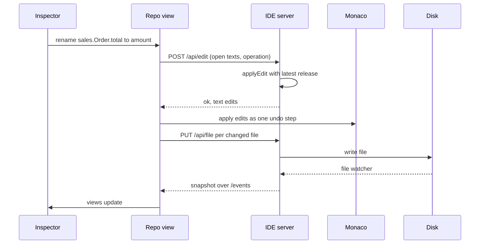

Every repo you open in [Appling Desktop](desktop.md) gets its own view, served by an IDE server that Desktop runs for that repo. In VS Code the [Appling extension](vscode.md) shows the same view in a tab per project, with the text in VS Code's own editors. With only the command line installed, [`appling ide`](cli.md#ide) opens it in your browser. The model canvas is the main area. Next to it a side panel holds the search, the inspector, the live changes, the review and the code tab, and the **Source** button in the header (**View › Toggle Source**) unfolds the text editor with the language server. All of them show the same model: the text is the source, the views are computed from it, and every change from the inspector goes back into the text.

> [!TIP]
> To try the repo view without installing anything, open the [demo](https://appling.tools/ide/). It runs the same view on the sample sales and CRM model entirely in your browser, language server included, with the source shown next to the canvas. Edits stay in the page until you reload; generation and the review of commits need Desktop.

The header shows the workspace folder, the release indicator (once a release exists), either `valid` or the number of errors in the model, and **Source** (**Hide source** while the editor is open).

AI works through agents in the repo's terminals, connected to the [MCP server](ai.md#mcp-server) of the repo as [agent sessions](ai.md#agent-sessions): their views and proposals show up here. **View › Toggle Code View** opens a full Code OSS (VS Code) next to the canvas, with the [Appling extension](editors.md#vs-code); selecting an element on the canvas opens its source there, and the cursor in a `.appling` file there selects the element on the canvas. On Linux, **text diff** in the Review tab opens there too, in Code OSS's diff editor.

## The editor

**Source** opens Monaco with one tab per file to the left of the canvas. It talks to an Appling language server that the repo's server starts for the view, so you get the same features as in any [LSP editor](editors.md): diagnostics, completion, hover with kind, qualified name and layer, go to definition, references, rename and formatting into canonical form. References to files that are not open resolve, because the server loads the whole workspace folder.

- Ctrl+S (Cmd+S on macOS) saves the current file.
- A dot after the file name marks a file whose text differs from the file on disk.
- When a file changes on disk, the editor replaces its text only when you have no unsaved changes in it. Unsaved work is never overwritten.

> [!TIP]
> To rename an element, use Rename in the inspector rather than the editor's rename (F2). The editor's rename comes from the language server and changes the declaration and its references only. The inspector runs the `rename` operation, which also follows names inside expressions, `@Name` in `does` texts, transitions and message keys, and records a migration step for released elements.

## The model canvas

The canvas draws the model as a tree that grows from a seed at the bottom, and it shows only what you unfold. The tabs at its top left choose the lens, the kinds of declarations the tree starts from:

| Lens | Starts from |
|---|---|
| Domain | Entities, value types and enums |
| Behavior | Actions, events, state machines and jobs |
| Application | Queries, projections, external systems and use cases |
| Interfaces | APIs, pages, navigations, flows and messages |
| Access | Roles, actors and tenants |

The tree unfolds one level per click, following the dependencies of the [semantic graph](../reference/graph.md) from what is used to what uses it:

1. The seed holds the modules that declare something of the lens.
2. A module holds its declarations of the lens, one bud per kind (such as `4 ENTITIES`) when there is more than one kind.
3. A declaration holds the declarations that use it, by kind again: an entity unfolds into its actions, queries, projections, machines and the pages that show it; an action into the machines, jobs, use cases, APIs and pages that run it.

Each circle has the color of its layer and the number of nodes it unfolds into. Next to it are the name, the kind and one fact that places it, such as `29 fields · 26 actions on it` for an entity, `on Order · draft, placed → cancelled` for an action, `every 0 3 * * * · runs Cancel` for a job or `/cms/quotes` for a page. A declaration from another module carries its qualified name. A declaration that already appears lower on its branch shows `↺` and does not unfold again. More than six folded declarations wrap into rows.

The [relevance](../language/relevance.md) of a declaration decides how it is drawn: the more relevant, the larger its circle and the closer to the middle of its row, while the least relevant sit small at the edges. `core` declarations have a stronger ring and a bolder name, `peripheral` ones are faded until you point at them.

Clicking a circle unfolds it and selects it: the inspector shows what it does, who may run it and where it is used, and every link there selects the next element. Clicking the selected declaration again folds it: what it held shrinks back into it. The canvas moves to keep what you unfolded in view. What stands stays where it is: new shoots go above their node, and where two crowns would meet, both lean out to their side instead of pushing the nodes below apart.

The tree is drawn as a plant. New shoots come out of the bud on top of the node you clicked, one after another, each on a stem that carries leaves and is thicker the more grows from it. Sap runs up the stems from the seed to the current node. A wave of rings spreads from a node when you unfold or fold it, and from every drawn element that a new version of the model added (green) or changed (blue), whether you, the inspector or an agent session wrote the change. With reduced motion set in your system, the plant stands still and has no waves.

With a server, the canvas also shows how far the code is: each declaration and module has a dot in the colour of its [implementation state](implementation.md#implementation-states) and a tag in words under its labels (`implemented`, `partly implemented`, `not implemented`, `code moved` or `code missing`); one that has no code yet is drawn hollow. The application comes first: until it was generated, the button under the path at the top left of the canvas reads **Generate the application**, which creates it from the whole model (asking for a stack first when there is none, see [Choosing a stack](#choosing-a-stack)). After that, the button offers **Generate** for the selected node while it has no code: the element with its members. A field lands in its entity's code, so generating it regenerates the entity's files.

- The path at the top left leads from the seed to the current node; click a step to go back to it.
- The line at the top right describes the current node, such as `quotes.Quote · entity · core · 29 fields · 26 actions on it · used by 84`.
- At the bottom, **link entities** adds [link entities](../language/domain.md#link-entities) such as join records, which are left out by default. The zoom level, **−** and **+** zoom, **Tasks** opens the [task board](implementation.md#registry-tasks-and-agent-sessions) with the count of open tasks, **Fit** shows the whole tree, and **Replant** folds it back to the seed. **Legend** explains every mark: the code states, requested elements, the change badges, dashed planned rings, buds, `↺`, claim rings and relevance. **Sound on** or **Sound off** switches the soft notes the plant plays: a rising run when shoots unfold, two falling notes on a fold and a short chime when the model changes. The choice is kept in your browser, and the first sound waits for your first click. Drag to pan and scroll to zoom.

### The right click menu

Right click a node for its menu. Right click the empty canvas for the menu of the seed.

| On | Item | Does |
|---|---|---|
| A declaration or module | **Edit in the inspector** | Selects it and shows the inspector, where you rename, retype and set its properties |
| A declaration or module | **Remove…** | Asks in the menu, then removes it with the `remove` [edit operation](#how-edits-are-applied) |
| The seed | **New module…** | A name and a description in your words: a request for an agent to model a module |
| A module, group or declaration | **New element…** | A kind, a name and a description: a request for an agent to model the element |
| A request | **Edit request…**, **New element on it…**, **Remove request** | Changes the request, asks for an element on top of it, or drops it with the requests built on it |

The kind list offers only what fits the place, following the [layer rules](../language/validation.md): the model as a whole takes a module, a module (or a requested module) takes any declaration, and a declaration takes the kinds that may reference it, since the tree grows what uses each node. Under an entity you can ask for an action, a query or another entity, under an action a use case or a page, never an entity. A group offers the kinds of the node it hangs under, with its own kind chosen.

A request does not touch the model. It is kept in `.appling/requests.json` in the workspace folder and drawn as a ghost with a dashed copper ring and its kind under the node you asked from (a group's requests go to its parent), tagged `requested · for an agent`. It counts for its parent's bud, and the parent unfolds to show it. A module that is still empty, or that holds requests, shows in every lens, so you can build on a module right after an agent wrote it. You can keep sketching on a request before any agent modeled it: a request built on another one waits for it and moves under the new element once that one is done. While an agent session works on a request, the ghost carries the session's ring and the tag `modeling · <session>`. An agent session takes it with the MCP tool [`request_next`](ai.md#request-tools), writes the element and closes it with `request_done`; the **Code** tab lists the waiting requests.

The lens and the link entities option are saved in `.appling/view.json` in the workspace folder, so the view opens the same way next time.

## Search

The Search tab finds any element of the model: entities, fields, actions, machines, transitions, queries, use cases, endpoints, pages and the rest.

- Without a query it lists every top level declaration, such as `sales.PlaceOrder` or `sales.Orders`.
- With a query it lists every element whose qualified name or kind contains all the words, ignoring case. `placeorder` finds the action with its error, effect and policy; `machine` finds every state machine.
- Results are grouped by layer. The layer buttons (Domain, Behavior, Application, Interfaces, Experience, Cross cutting) choose which layers the list includes; all are on by default.
- The first 200 results are shown; refine the query to see others.

Click a result to open it in the inspector.

## Selection

Selection is shared between text, canvas and inspector:

- Moving the cursor in the editor (or in a `.appling` file of the code view) selects the innermost element at the cursor. When the lens starts from the kind of the declaration that contains it, the canvas unfolds its module and marks it.
- Clicking a circle, a module, a search result or a link in the inspector selects that element, opens the Inspector tab and reveals its source in the editor while it is open, switching files when needed.

## The inspector

The Inspector tab shows the selected element: its kind and layer, its qualified name (in VS Code with **Open source**, which opens its declaration in VS Code's editor), and

- **What it does**, for an action: the entity it works on, its inputs, what it requires (with the error raised otherwise), what it changes (its own effects, then each machine transition it drives with that transition's effects), its errors and its consistency,
- **Actions**, for an entity: the actions declared on it, each with the machine transitions it drives, such as `draft, placed -> cancelled`, followed by the actions elsewhere that create its records, marked `creates`,
- **What they can do**, for an actor: what this person may do, by the [simulator](simulator.md#how-it-decides), in five groups: Actions, Pages, Use cases, Queries and Data (each entity operation, and fields that a policy guards separately). Only what the actor may do is listed: each entry says `may` or `depends on the data` and lists the policies that decide it with their conditions. What the actor is refused is left out, and so is a group with nothing allowed. A page also lists the actions it offers that the actor may use, because seeing a page does not mean being allowed to use its buttons,
- its [implementation state](implementation.md#implementation-states), with its open registry tasks, **Open code** (the element's code, see [From the model to the code and back](implementation.md#from-the-model-to-the-code-and-back)) and **Generate** (the element with its members, when `appling.config.json` has targets),
- **Code**: where the element is implemented, one `file:start-end` line per [code reference](references.md), with its status when it is not `current`. Expand one to read its lines,
- **line**, when the cursor or a code link selected a declaring line that is no element, such as a use case step, a handler, a `requires`, a page component, a navigation item or a message: its [sub-anchor](../reference/graph.md#sub-anchors) (`#step[2]`), its own implementation state and **Open code** for its own code references. The canvas shows its element. Such a line has its own gutter mark, its element's state until it has a code reference of its own,
- **text diff**, while the canvas marks the element as added, changed or removed (by the Review tab or as a live change): with the review's marks it opens the element's text diff at the review's commit, in Desktop's code view where it runs, else below; with the live marks it opens the Changes tab at the file's diff,
- **Members**: the elements inside it, one line each, such as `status: OrderStatus state` for a field,
- **Used by**: every declaration that references the element or one of its members, grouped by layer. For an entity this is the overview of its behavior and use: the events, actions, machines and jobs in Behavior, the queries, projections and use cases in Application, the endpoints in Interfaces and the pages in Experience,
- **Uses**: every declaration the element or one of its members references, grouped by layer.

Used by and Uses lift each reference to its top level declaration and say which members it runs through. For the field `sales.Order.placed_at`, Used by shows `sales.PlaceOrder action via effect[set placed_at]` and `sales.OpenOrders query`, which sorts by it. For the action `sales.PlaceOrder`, it shows `sales.OrderFlow machine via transition[draft->placed]`, `sales.PublicApi interface via endpoint[POST /orders/{id}/place]` and the page `sales.OrderDetail`. For Uses, the members are the element's own: the entity `sales.Order` uses `crm.Account` via `customer`. Every entry is a link that selects that element.

For an action the inspector also shows **Who may trigger it**, each actor that may trigger it with `may` or `depends on the data`, and **Invariants at risk**, the invariants that read a field the action changes. For a machine it shows **Reachable states**, each state with the triggers of the shortest path to it. The [simulator](simulator.md) answers both.

### Editing in the inspector

The inspector edits the model. Each field submits one [edit operation](../reference/edit-operations.md):

| Field | Shown for | Operation |
|---|---|---|
| Name, Rename | Named elements except modules | `rename` |
| Type, Retype | Fields and parameters | `retype` |
| One field per property, Set | Every property the element has, such as `default`, `modifiers`, `condition` or `preconditions`, except the `link` marker of an entity, which you change in the text | `set`; an empty value removes the property |
| Add a member, Add | Every element | `add`, with the member's source text, such as `note: Text?` or `entity Customer { name: String }` |
| Remove | Every element except top level modules; asks for confirmation | `remove` |

When the model rejects an edit, the inspector lists the reasons, such as `Unknown name "total".`, and nothing changes.

## How edits are applied

Every change from the inspector and every accepted proposal of an agent session runs through the same path:

1. The client sends the current text of every open file, saved or not, with the operation to `/api/edit`.
2. The server runs `applyEdit` on those texts with the latest release. It writes nothing. The touched element is printed canonically, renames follow every place that names the element, and the edit is rejected when it does not parse or adds a validation error.
3. The client applies the returned text edits to the editor as one undoable step per file.
4. The client saves every changed file. The file watcher then pushes a new snapshot, and the views update.

Because edits work on the texts in the editor, an edit sees your unsaved changes too, and saving the edited file also saves them. Ctrl+Z in the editor undoes an edit like any other change; save again to write the undone text.

After a rename, the selection moves to the new name.

## Reviewing changes

The **Review** tab of the side panel shows what changed in a workspace that lives in a git repository. By default it compares the working tree with `HEAD`, so you see the uncommitted changes; the picker on top compares it with any of the latest 50 commits that touch the workspace folder instead.

- **Model** lists the elements that were added, changed or removed, by qualified name. A changed element names the properties that differ and how many of its references changed. A rename recorded as a migration step (see [Migrations](../language/migrations.md)) shows as one change with its old name, not as a removal and an addition. Click an element to select it on the canvas; **text diff** shows the element's text at the commit and now.
- **Files** lists every file of the workspace folder that differs from the commit, `.appling` or not: added (A), modified (M), deleted (D), renamed (R) and untracked (U). Click one for its text diff.
- **mark on the canvas** (on by default) marks the changes on the canvas: added declarations glow green, changed ones and the modules that hold changes glow yellow, and removed declarations are drawn ghosted with a dashed circle where they were.

The tab follows every change on disk. The server reads git with the git CLI: `git ls-tree` and `git show` for the `.appling` files at the commit, which it builds into a graph the same way as the working tree, and `git diff --name-status` plus `git status --porcelain` for the changed files. A folder outside git shows a message instead. The code view takes over the text diffs where it runs (see below); elsewhere they show in the panel.

| Endpoint | Returns |
|---|---|
| `GET /api/diff?rev=HEAD` | `{ ok, rev, commit, files, diff, before }`: the changed files, the model diff (`diffGraphs` of `@appling/model/diff`) and the model at the commit (graph, files, locations); `{ ok: false, error }` outside git or for an unknown revision |
| `GET /api/diff/file?rev=&path=&before=` | One file at the commit and now, `null` where it does not exist |
| `GET /api/revisions` | The latest commits that touch the workspace folder |

> [!NOTE]
> The code view opens text diffs in its own editor: when `window.applingDesktop.openTextDiff(request)` exists, **text diff** calls it with the file path, the commit, the line and the element's qualified name instead of showing the diff in the panel.

## Live changes

Every change to the model is marked on the canvas the moment it lands on disk, whoever wrote it: an [agent session](ai.md#agent-sessions) through the MCP tools, an agent or editor that writes the files directly, `appling fmt` or a `git checkout`. Each changed node gets a pulsing halo, a letter on its circle as Source Control marks files (A added, M changed, D removed) and its name in the change's colour: added declarations green, changed ones and the modules that hold them blue, removed declarations red and dashed, drawn ghosted where they were. Marking never moves the camera and never unfolds the tree: what you look at stays where it is.

The changes are compared with a baseline: the text of each model file when you last accepted it. When the IDE server starts, the baseline is the files on disk, so only what changes while you work is marked; what differs from the last commit is what the [Review](#reviewing-changes) tab shows. Your own saves from the editor and the inspector move the baseline with them, unless the file already has an unseen change, which then stays marked. The baseline lives in the server's memory: a restart of the server accepts every change.

The **Changes** tab of the side panel, with the count of unseen changed files on its tab, lists them per file, newest first:

- the file with its status (A added, M modified, D deleted), the agent sessions whose tool calls wrote it in their colour, or **written to disk** for any other writer, and when it last changed,
- the model changes in the file: the elements added, changed (with the properties that differ) or removed; click one to select it,
- **text diff**: the file as last accepted and now,
- **Accept** moves the file's baseline to its text now, so it is no longer marked; **accept all** does it for every file,
- **Revert** writes the text last accepted back to disk, or deletes a file that did not exist then.

While the Review tab marks its own diff on the canvas, the review's marks replace the live ones.

### Agent views and proposals

The [visual tools](ai.md#visual-tools) of the repo's agent sessions draw on this canvas. A view a session shows, with its bubbles, its current step and its last reply, waits as a chip at the top right of the canvas under the session's name and colour. Click it to open the view: the canvas draws the session's tree, flowchart or cards, one bubble at a time with Back and Next, and follows each new view and bubble of that session; **Back to the model** returns to your own tree. Nothing opens by itself. The field under the view's bar sends the session a question: it reaches the session's inbox as a message from User, stays listed in the view, and the session's answer (`visual_reply`) shows below it.

A change a session proposes with `propose_edits` shows at the top of the Changes tab with its summary, text and model differences and a comment field; a banner on the canvas points there while the tab is closed. **Accept** writes it and **Reject** sends your comment back to the agent, whose tool call waits for the decision. When the session ends, its views go and its waiting proposals are rejected.

## The Code tab

The **Code** tab shows how far the model is implemented and generates from the repo view: the count of elements per [implementation state](implementation.md#implementation-states), the targets of `appling.config.json`, buttons to generate the outstanding elements, the selected element, the checked ones or everything, the running generation with its log, the elements [requested](#the-right-click-menu) on the canvas, waiting for an agent, and the open registry tasks with their status, attempts, notes and the agent session that claimed each. The tab counts the open tasks. See [Seed to code](implementation.md).

The editor marks each model line with the state of the element it declares, and the canvas marks each declaration; after a model change adds outstanding elements, the canvas offers to generate them.

### Choosing a stack

Generating needs a target in `appling.config.json`. Without one, every Generate button asks for the stack first: Django, Ash, Go or Rust. The choice adds its target (`build/<folder name>`) to `appling.config.json` and the stack's local files to `.gitignore`, as `appling init --stack` does, and the generation runs; its first run creates the whole application. Appling Desktop and the VS Code extension come with the four generators, so nothing needs installing; a generator the project installed itself (`npm install --save-dev @appling/codegen-django`) wins, which pins its version. The server takes the choice at `POST /api/targets` with `{ "stack": "django" }`.

## Releases and migration steps

Once the workspace has a release (`appling release 1.0.0`, see [CLI](cli.md#release)), the header shows a button such as `release 1.0.0 · 2 migration step(s) since`. It counts the steps in the `since_v1_0_0` blocks of all modules; click it to select the first such block.

Renaming, retyping or removing a released domain element from the inspector or an accepted proposal appends the matching migration step automatically. See [Edit operations](../reference/edit-operations.md#release-aware-edits). The view reads the latest release when it loads; reload it (**View › Reload Repo View**) after creating a release.

## Live updates

The server watches the workspace folder for changes to `.appling` files (ignoring hidden folders and `node_modules`), to `appling.config.json`, `.appling/references.json`, `.appling/generation.json` and the registries of the generate targets inside the folder, and pushes a new snapshot to the view about 100 ms after the last change. Edits from another editor, `appling fmt` or an AI agent through the [MCP server](ai.md#mcp-server) appear in the views without a reload.

The canvas also marks what [agent sessions](ai.md#agent-sessions) of the repo claimed or highlighted: a dashed ring in the session's colour around the declaration, with the session's label in its tooltip. In [Appling Desktop](desktop.md#agent-sessions) a click on the ring goes to the session's terminal tab.

## Theme

The IDE's colours and fonts are CSS variables on the page's root, so a host can replace any of them: `--appling-surface`, `--appling-surface-raised`, `--appling-surface-elevated` and `--appling-surface-hover` (backgrounds), `--appling-line` and `--appling-line-strong` (borders), `--appling-ink`, `--appling-ink-soft` and `--appling-ink-muted` (text), the accents `--appling-leaf`, `--appling-sprout`, `--appling-rust`, `--appling-amber` and `--appling-copper`, `--appling-info`, `--appling-danger` and `--appling-shadow`, the canvas's `--appling-canvas-glow`, `--appling-root`, `--appling-branch` and `--appling-seed`, the change colours `--appling-change-added`, `-changed` and `-removed`, the layer colours `--appling-layer-domain`, `-behavior`, `-application`, `-interface`, `-experience` and `-cross`, and `--appling-font-sans` and `--appling-font-mono`. The editor takes its colours from them too.

The IDE is dark. `data-theme="light"` on the root picks its light palette. A host that embeds the IDE with `?host=frame` sends `{ type: 'theme', kind: 'light' | 'dark', tokens }` to the frame: the kind sets `data-theme` and the tokens replace the IDE's own, until the next theme message. The [VS Code extension](vscode.md#theme) sends VS Code's theme this way, at first and on every change.

## Security

Each repo's IDE server is meant for your machine only:

- It listens on `127.0.0.1` only, never on other interfaces.
- Every request and websocket must carry a `Host` header of `127.0.0.1:<port>` or `localhost:<port>`, and an `Origin` header, when present, must be one of `http://127.0.0.1:<port>` and `http://localhost:<port>`. Anything else gets `403 Forbidden`. This blocks other websites and DNS rebinding.
- The file endpoint writes only `.appling` files inside the workspace folder.
- Its page may be embedded only by itself and by VS Code's webviews and the VS Code window that holds them (`Content-Security-Policy: frame-ancestors 'self' vscode-webview: vscode-file: https://*.vscode-cdn.net`). An app that started the server over IPC may add one trusted origin at a time with `{ type: "trust", origin }`, such as the VS Code extension for a port forwarded from a remote window.

The server endpoints, for reference:

| Endpoint | Does |
|---|---|
| `GET /api/snapshot` | Files, graph, dependencies, source locations, code references and errors |
| `POST /api/edit` | Runs one edit operation on the texts sent; writes nothing |
| `GET`, `PUT /api/view` | Reads and writes `.appling/view.json` |
| `PUT /api/file?path=` | Writes one `.appling` file |
| `GET /api/release` | Version and date of the latest release, or `null` |
| `POST /mcp` | The repo's MCP server for [agent sessions](ai.md#agent-sessions); needs a session's bearer token |
| `GET`, `POST /api/sessions` | Lists the agent sessions, opens one (returns its token and the MCP URL) |
| `PATCH`, `DELETE /api/sessions/<id>` | Renames a session or sets its status, ends it |
| `POST /api/sessions/<id>/ask` | Delivers `{ text }`, a question typed in the session's view, to its inbox |
| `POST /api/live/accept` | Accepts the live changes of `{ paths }`, or of every changed file; returns the changes left |
| `POST /api/live/revert` | Writes the text last accepted of `{ path }` back |
| `POST /api/proposals/<id>` | Decides a waiting proposal with `{ decision: { accepted, comment? } }` |
| websocket `/events` | Snapshot pushes on file changes, the live changes (`live`), the agent sessions, their `ide_act` actions, views (`agent-view`) and proposals; the view reports its selection, view, the agent view it shows on it |
| websocket `/lsp` | One language server per connection |
