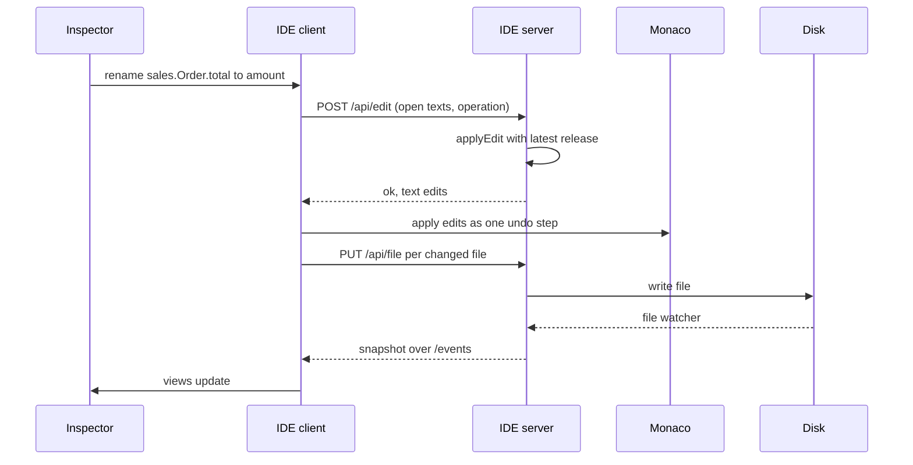

The Appling IDE (`@appling/ide`) is a local web application. It puts three panes side by side: the text editor with the language server, the entity view, and a side panel with the search, the inspector and the AI chat. All of them show the same model: the text is the source, the views are computed from it, and every change from the inspector goes back into the text.

## Start the IDE

```sh
npx @appling/ide [folder] [--port 4410]
```

| Argument | Default | Meaning |
|---|---|---|
| `folder` | the current folder | The workspace: every `.appling` file below it, searched recursively, skipping hidden folders and `node_modules` |
| `--port <number>` | `4410` | The port on `127.0.0.1` |

```sh
npx @appling/ide examples
```

```
Appling IDE for /home/you/project/examples at http://127.0.0.1:4410
```

Open the printed address in your browser. The package also installs the binary `appling-ide`, so after `npm install --save-dev @appling/ide` you can run `npx appling-ide models`.

The header shows the workspace folder, the release indicator (once a release exists) and either `valid` or the number of errors in the model.

## The editor

The left pane is Monaco with one tab per file. It talks to an Appling language server that the IDE starts for the page, so you get the same features as in any [LSP editor](editors.md): diagnostics, completion, hover with kind, qualified name and layer, go to definition, references, rename and formatting into canonical form. References to files that are not open resolve, because the server loads the whole workspace folder.

- Ctrl+S (Cmd+S on macOS) saves the current file.
- A dot after the file name marks a file whose text differs from the file on disk.
- When a file changes on disk, the IDE replaces its text only when you have no unsaved changes in it. Unsaved work is never overwritten.

> [!TIP]
> To rename an element, use Rename in the inspector rather than the editor's rename (F2). The editor's rename comes from the language server and changes the declaration and its references only. The inspector runs the `rename` operation, which also follows names inside expressions, export lists, transitions and message keys, and records a migration step for released elements.

## The entity view

The middle pane shows the business model at a glance: every module as a box, the entities inside it, and the associations between entities. It is computed from the [semantic graph](../reference/graph.md) and shows nothing else, so it stays readable in large models:

- Each entity is one card with its name and the number of actions declared on it. Fields, invariants and policies are not drawn; select the entity to see them in the inspector.
- An arrow from one entity to another stands for the fields that reference it, labeled with their names. `[]` marks a list and `?` an optional field, so `lines[]` reads as "has many". A field whose type is the entity itself draws no arrow.
- Enums, value types and every declaration of the other layers stay out of the view, and so do the fields that use them.
- Nested modules sit inside their enclosing module. Modules without entities are left out.

The view is laid out automatically. Pan and zoom with the mouse or the buttons in the corner; zooming only scales the view, it never shows more or less.

When you select an entity, everything that is not associated with it fades, so its neighbors stand out. Selecting anything else, or the module, shows the whole view again.

### View options

**View** in the corner of the entity view opens the options. Every change applies at once and is saved in `.appling/view.json` in the workspace folder, so the IDE opens the same way next time.

| Option | Default | Shows |
|---|---|---|
| Link entities | off | [Link entities](../language/domain.md#link-entities), such as join records, grayed out and tagged `link`, with their arrows. The label counts the link entities in the model; mark an entity with `entity link` to have one |
| Modules without entities | off | Modules whose entities are all hidden, or that have none, as empty boxes |
| Field names on arrows | on | The field names on the association arrows |
| Action count on entities | on | The number of actions declared on each entity, such as `2 actions` |
| Focus on the selected entity | on | Fades what is not associated with the selected entity |
| Direction | Left to right | The direction of the layout: `Left to right` or `Top to bottom` |
| Arrows | Curved | How arrows are drawn: `Curved`, `Right angled` or `Straight` |

## Search

The Search tab finds any element of the model: entities, fields, actions, machines, transitions, queries, use cases, endpoints, pages and the rest.

- Without a query it lists every top level declaration, such as `sales.PlaceOrder` or `sales.Orders`.
- With a query it lists every element whose qualified name or kind contains all the words, ignoring case. `placeorder` finds the action with its error, effect and policy; `machine` finds every state machine.
- Results are grouped by layer. The layer buttons (Domain, Behavior, Application, Interfaces, Experience, Cross cutting) choose which layers the list includes; all are on by default.
- The first 200 results are shown; refine the query to see others.

Click a result to open it in the inspector.

## Selection

Selection is shared between text, entity view and inspector:

- Moving the cursor in the editor selects the innermost element at the cursor. The entity view highlights the entity that contains it, or else its module.
- Clicking an entity, a module, a search result or a link in the inspector selects that element, opens the Inspector tab and reveals its source in the editor, switching files when needed.

## The inspector

The Inspector tab shows the selected element: its kind and layer, its qualified name, and

- **What it does**, for an action: the entity it works on, its inputs, what it requires (with the error raised otherwise), what it changes (its own effects, then each machine transition it drives with that transition's effects), its errors and its consistency,
- **Actions**, for an entity: the actions declared on it, each with the machine transitions it drives, such as `draft, placed -> cancelled`, followed by the actions elsewhere that create its records, marked `creates`,
- **What they can do**, for an actor: what this person may do, by the [simulator](simulator.md#how-it-decides), in five groups: Actions, Pages, Use cases, Queries and Data (each entity operation, and fields that a policy guards separately). Every entry says `may`, `depends on the data` or `may not`, and lists the policies that decide it with their conditions, or `no policy` when nothing guards it. A page also lists the actions it offers with their own verdicts, because seeing a page does not mean being allowed to use its buttons. Refused entries are folded under `may not` with their count,
- **Members**: the elements inside it, one line each, such as `status: OrderStatus state` for a field,
- **Used by**: every declaration that references the element or one of its members, grouped by layer. For an entity this is the overview of its behavior and use: the events, actions, machines and jobs in Behavior, the queries, projections and use cases in Application, the endpoints in Interfaces and the pages in Experience,
- **Uses**: every declaration the element or one of its members references, grouped by layer.

Used by and Uses lift each reference to its top level declaration and say which members it runs through. For the field `sales.Order.placed_at`, Used by shows `sales.PlaceOrder action via effect[set placed_at]` and `sales.OpenOrders query`, which sorts by it. For the action `sales.PlaceOrder`, it shows `sales.OrderFlow machine via transition[draft->placed]`, `sales.PublicApi interface via endpoint[POST /orders/{id}/place]` and the page `sales.OrderDetail`. For Uses, the members are the element's own: the entity `sales.Order` uses `crm.Account` via `customer`. Every entry is a link that selects that element.

For an action the inspector also shows **Who may trigger it**, each actor with `may`, `may not` or `depends on the data`, and **Invariants at risk**, the invariants that read a field the action changes. For a machine it shows **Reachable states**, each state with the triggers of the shortest path to it. The [simulator](simulator.md) answers both.

### Editing in the inspector

The inspector edits the model. Each field submits one [edit operation](../reference/edit-operations.md):

| Field | Shown for | Operation |
|---|---|---|
| Name, Rename | Named elements except modules | `rename` |
| Type, Retype | Fields and parameters | `retype` |
| One field per property, Set | Every property the element has, such as `default`, `modifiers`, `condition` or `preconditions`, except the `link` marker of an entity, which you change in the text | `set`; an empty value removes the property |
| Add a member, Add | Every element | `add`, with the member's source text, such as `note: Text?` or `entity Customer { name: String }` |
| Remove | Every element except top level modules; asks for confirmation | `remove` |

When the model rejects an edit, the inspector lists the reasons, such as `Unknown name "total".`, and nothing changes.

## How edits are applied

Every change from the inspector and accepted AI proposals runs through the same path:

1. The client sends the current text of every open file, saved or not, with the operation to `/api/edit`.
2. The server runs `applyEdit` on those texts with the latest release. It writes nothing. The touched element is printed canonically, renames follow every place that names the element, and the edit is rejected when it does not parse or adds a validation error.
3. The client applies the returned text edits to the editor as one undoable step per file.
4. The client saves every changed file. The file watcher then pushes a new snapshot, and the views update.



Because edits work on the texts in the editor, an edit sees your unsaved changes too, and saving the edited file also saves them. Ctrl+Z in the editor undoes an edit like any other change; save again to write the undone text.

After a rename, the selection moves to the new name.

## The AI tab

The AI tab is a chat about the model. Ask a question ("which actions change Order?") or ask for a change ("add an invoice entity with a due date"). The assistant uses the model tools described in [AI tools](ai.md): it looks elements up with `graph_query` and `read_source`, checks the model with `check` and changes it with `edit`. The tools it calls are listed above its answer.

The assistant never writes your files. It edits a working copy, and when the turn ends with changes it shows a proposal:

- the number of edits,
- the text differences per file (removed lines with `-`, added lines with `+`),
- the graph elements added, changed and removed; added and changed ones are links that select the element.

**Accept** replays the proposal's operations one by one through the same path as an inspector edit, so they land in the editor as undoable steps and are saved. If one is rejected, for example because you changed the text in the meantime, the remaining ones are not applied and the reasons appear in the chat. **Reject** discards the proposal.

The assistant reads the files on disk, so save before you ask about unsaved changes.

Configure the model in `appling.config.json` and set the provider's API key in the environment before you start the IDE:

```json
{ "ai": { "provider": "anthropic", "model": "claude-opus-5-5" } }
```

```sh
ANTHROPIC_API_KEY=... npx @appling/ide models
```

The defaults, the OpenAI provider and the settings are described in [AI tools](ai.md#ide-chat).

## Releases and migration steps

Once the workspace has a release (`appling release 1.0.0`, see [CLI](cli.md#release)), the header shows a button such as `release 1.0.0 · 2 migration step(s) since`. It counts the steps in the `since_v1_0_0` blocks of all modules; click it to select the first such block.

Renaming, retyping or removing a released domain element from the inspector or an accepted proposal appends the matching migration step automatically. See [Edit operations](../reference/edit-operations.md#release-aware-edits). The IDE reads the latest release when the page loads; reload the page after creating a release.

## Live updates

The server watches the workspace folder for changes to `.appling` files (ignoring hidden folders and `node_modules`) and pushes a new snapshot to the page about 100 ms after the last change. Edits from another editor, `appling fmt` or an AI agent through the [MCP server](ai.md#mcp-server) appear in the views without a reload.

## Security

The IDE is meant for your machine only:

- It listens on `127.0.0.1` only, never on other interfaces.
- Every request and websocket must carry a `Host` header of `127.0.0.1:<port>` or `localhost:<port>`, and an `Origin` header, when present, must be one of `http://127.0.0.1:<port>` and `http://localhost:<port>`. Anything else gets `403 Forbidden`. This blocks other websites and DNS rebinding.
- The file endpoint writes only `.appling` files inside the workspace folder.

The server endpoints, for reference:

| Endpoint | Does |
|---|---|
| `GET /api/snapshot` | Files, graph, dependencies, source locations and errors |
| `POST /api/edit` | Runs one edit operation on the texts sent; writes nothing |
| `GET`, `PUT /api/view` | Reads and writes `.appling/view.json` |
| `PUT /api/file?path=` | Writes one `.appling` file |
| `GET /api/release` | Version and date of the latest release, or `null` |
| `POST /api/chat` | One chat turn as a stream of JSON lines |
| websocket `/events` | Snapshot pushes on file changes |
| websocket `/lsp` | One language server per connection |
