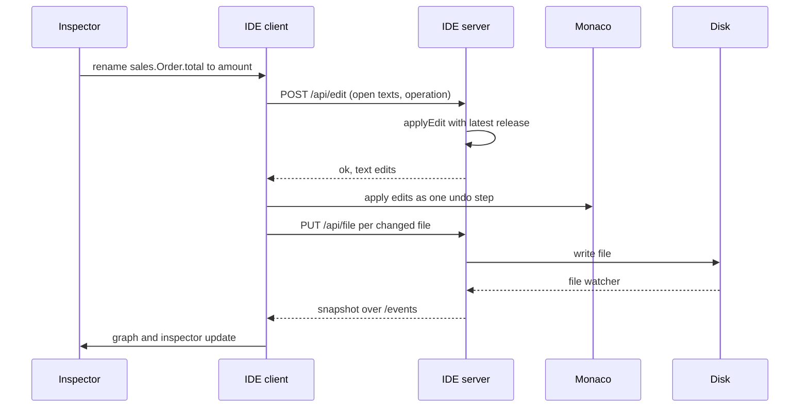

The Appling IDE (`@appling/ide`) is a local web application. It puts three panes side by side: the text editor with the language server, the semantic graph, and a side panel with the inspector and the AI chat. Text and graph always show the same model: the text is the source, the graph is computed from it, and every change from the graph or the inspector goes back into the text.

## Start the IDE

```sh
npx @appling/ide [folder] [--port 4410]
```

| Argument | Default | Meaning |
|---|---|---|
| `folder` | the current folder | The workspace: every `.appling` file below it, searched recursively, skipping hidden folders and `node_modules` |
| `--port <number>` | `4410` | The port on `127.0.0.1` |

```sh
npx @appling/ide examples
```

```
Appling IDE for /home/you/project/examples at http://127.0.0.1:4410
```

Open the printed address in your browser. The package also installs the binary `appling-ide`, so after `npm install --save-dev @appling/ide` you can run `npx appling-ide models`.

The header shows the workspace folder, the release indicator (once a release exists) and either `valid` or the number of errors in the model.

## The editor

The left pane is Monaco with one tab per file. It talks to an Appling language server that the IDE starts for the page, so you get the same features as in any [LSP editor](editors.md): diagnostics, completion, hover with kind, qualified name and layer, go to definition, references, rename and formatting into canonical form. References to files that are not open resolve, because the server loads the whole workspace folder.

- Ctrl+S (Cmd+S on macOS) saves the current file.
- A dot after the file name marks a file whose text differs from the file on disk.
- When a file changes on disk, the IDE replaces its text only when you have no unsaved changes in it. Unsaved work is never overwritten.

> [!TIP]
> To rename an element, use Rename in the inspector rather than the editor's rename (F2). The editor's rename comes from the language server and changes the declaration and its references only. The inspector runs the `rename` operation, which also follows names inside expressions, export lists, transitions and message keys, and records a migration step for released elements.

## The graph

The middle pane draws the [semantic graph](../reference/graph.md) with semantic zoom: what you see depends on how far you zoom in. The buttons in the corner switch levels directly.

| Level | Button | Shows |
|---|---|---|
| Zoomed out | Modules | Every module with its use cases, and the dependencies between modules, labeled with the number of references behind each |
| Medium | Declarations | The top level declarations of each module, grouped in their module, and the references between them |
| Zoomed in | Members | The declarations with their members as rows, such as `status: OrderStatus state` |

At the declaration and member levels, references between members are drawn between the cards that contain them, one line per pair of cards, labeled with the reference kinds behind it (such as `entity, type`).

### Layer views

At the declaration and member levels, the layer buttons (Domain, Behavior, Application, Interfaces, Experience, Cross cutting) choose which layers the graph shows. Only declarations of the chosen layers appear, and only the references among them. Domain alone is the default. Pick Domain and Behavior to see which actions and machines work on which entities; pick Interfaces and Application to see what each endpoint exposes. The choice is saved with the layout.

### Selection

Selection is shared between text, graph and inspector:

- Moving the cursor in the editor selects the innermost element at the cursor. The graph highlights its card, or its row when zoomed in, or the nearest shown card that contains it.
- Clicking a card, a row or a link in the inspector selects that element and reveals its source in the editor, switching files when needed.

### Positions

The graph is laid out automatically. Drag a card to place it yourself; the position is saved per zoom level and relative to the module that contains the card. Saved positions win over the automatic layout.

## The inspector

The Inspector tab shows the selected element: its kind and layer, its qualified name, and

- **Contains**: the elements inside it,
- **Refers to**: what it references, with the reference kind,
- **Referred by**: what references it.

Every entry is a link that selects that element.

For an action the inspector also shows **Who may trigger it**, each actor with `may`, `may not` or `depends on the data`, and **Invariants at risk**, the invariants that read a field the action changes. For a machine it shows **Reachable states**, each state with the triggers of the shortest path to it. The [simulator](simulator.md) answers both.

### Editing in the inspector

The inspector edits the model. Each field submits one [edit operation](../reference/edit-operations.md):

| Field | Shown for | Operation |
|---|---|---|
| Name, Rename | Named elements except modules | `rename` |
| Type, Retype | Fields and parameters | `retype` |
| One field per property, Set | Every property the element has, such as `default`, `modifiers`, `condition` or `preconditions` | `set`; an empty value removes the property |
| Add a member, Add | Every element | `add`, with the member's source text, such as `note: Text?` or `entity Customer { name: String }` |
| Remove | Every element except top level modules; asks for confirmation | `remove` |

When the model rejects an edit, the inspector lists the reasons, such as `Unknown name "total".`, and nothing changes.

## Editing in the graph

Two gestures edit the model from the graph:

- **Drag a connection** (at the declaration and member levels) from the right handle of an entity, value type or event to an entity, enum or value type. This adds a field that references the target, named after it with a lower case first letter: dragging from `Order` to `Customer` adds `customer: Customer`. A target in another module is referenced by its qualified name, such as `crm.Account`, which works only when that module exports it.
- **Press Delete** to remove the selected card. The removal runs as a `remove` operation and is rejected when other elements still reference it.

A rejected gesture shows its reasons over the graph; click the message to close it.

## How edits are applied

Every change from the inspector, the graph and accepted AI proposals runs through the same path:

1. The client sends the current text of every open file, saved or not, with the operation to `/api/edit`.
2. The server runs `applyEdit` on those texts with the latest release. It writes nothing. The touched element is printed canonically, renames follow every place that names the element, and the edit is rejected when it does not parse or adds a validation error.
3. The client applies the returned text edits to the editor as one undoable step per file.
4. The client saves every changed file. The file watcher then pushes a new snapshot, and graph and inspector update.



Because edits work on the texts in the editor, an edit sees your unsaved changes too, and saving the edited file also saves them. Ctrl+Z in the editor undoes an edit like any other change; save again to write the undone text.

After a rename, the selection and the saved graph positions move to the new name.

## The AI tab

The AI tab is a chat about the model. Ask a question ("which actions change Order?") or ask for a change ("add an invoice entity with a due date"). The assistant uses the model tools described in [AI tools](ai.md): it looks elements up with `graph_query` and `read_source`, checks the model with `check` and changes it with `edit`. The tools it calls are listed above its answer.

The assistant never writes your files. It edits a working copy, and when the turn ends with changes it shows a proposal:

- the number of edits,
- the text differences per file (removed lines with `-`, added lines with `+`),
- the graph elements added, changed and removed; added and changed ones are links that select the element.

**Accept** replays the proposal's operations one by one through the same path as an inspector edit, so they land in the editor as undoable steps and are saved. If one is rejected, for example because you changed the text in the meantime, the remaining ones are not applied and the reasons appear in the chat. **Reject** discards the proposal.

The assistant reads the files on disk, so save before you ask about unsaved changes.

Configure the model in `appling.config.json` and set the provider's API key in the environment before you start the IDE:

```json
{ "ai": { "provider": "anthropic", "model": "claude-opus-5-5" } }
```

```sh
ANTHROPIC_API_KEY=... npx @appling/ide models
```

The defaults, the OpenAI provider and the settings are described in [AI tools](ai.md#ide-chat).

## Releases and migration steps

Once the workspace has a release (`appling release 1.0.0`, see [CLI](cli.md#release)), the header shows a button such as `release 1.0.0 · 2 migration step(s) since`. It counts the steps in the `since_v1_0_0` blocks of all modules; click it to select the first such block.

Renaming, retyping or removing a released domain element from the inspector, the graph or an accepted proposal appends the matching migration step automatically. See [Edit operations](../reference/edit-operations.md#release-aware-edits). The IDE reads the latest release when the page loads; reload the page after creating a release.

## Layout persistence

Positions and the chosen layers live in `.appling/layout.json` in the workspace folder, outside the model, so they never show up in model diffs. The IDE writes the file whenever you move a card or change the layers. Saved positions follow renames: a rename in the IDE moves them at once, and renames recorded as migration steps carry older positions over to the new names. The format is on [Configuration](../reference/configuration.md#layout).

Commit the file if your team should share the layout, or ignore it.

## Live updates

The server watches the workspace folder for changes to `.appling` files (ignoring hidden folders and `node_modules`) and pushes a new snapshot to the page about 100 ms after the last change. Edits from another editor, `appling fmt` or an AI agent through the [MCP server](ai.md#mcp-server) appear in the graph without a reload.

## Security

The IDE is meant for your machine only:

- It listens on `127.0.0.1` only, never on other interfaces.
- Every request and websocket must carry a `Host` header of `127.0.0.1:<port>` or `localhost:<port>`, and an `Origin` header, when present, must be one of `http://127.0.0.1:<port>` and `http://localhost:<port>`. Anything else gets `403 Forbidden`. This blocks other websites and DNS rebinding.
- The file endpoint writes only `.appling` files inside the workspace folder.

The server endpoints, for reference:

| Endpoint | Does |
|---|---|
| `GET /api/snapshot` | Files, graph, dependencies, source locations and errors |
| `GET`, `PUT /api/layout` | Reads and writes `.appling/layout.json` |
| `POST /api/edit` | Runs one edit operation on the texts sent; writes nothing |
| `PUT /api/file?path=` | Writes one `.appling` file |
| `GET /api/release` | Version and date of the latest release, or `null` |
| `POST /api/chat` | One chat turn as a stream of JSON lines |
| websocket `/events` | Snapshot pushes on file changes |
| websocket `/lsp` | One language server per connection |
